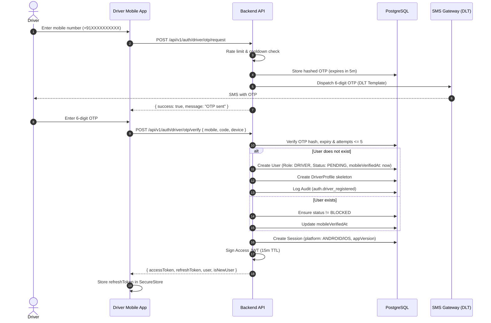
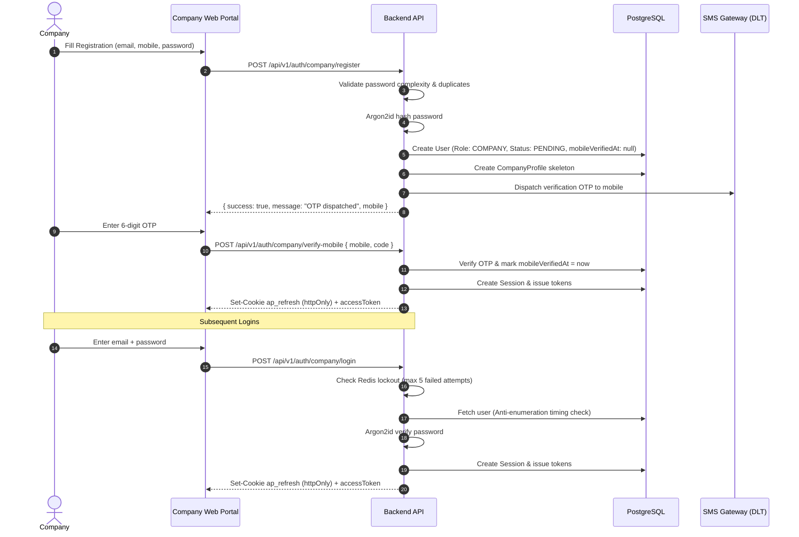
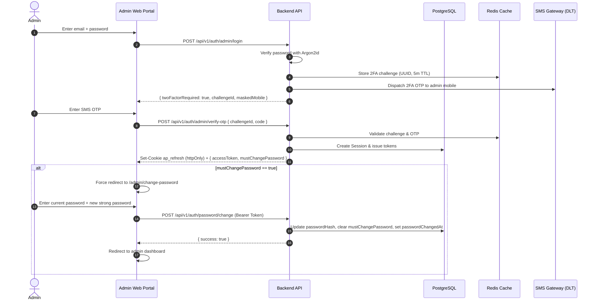
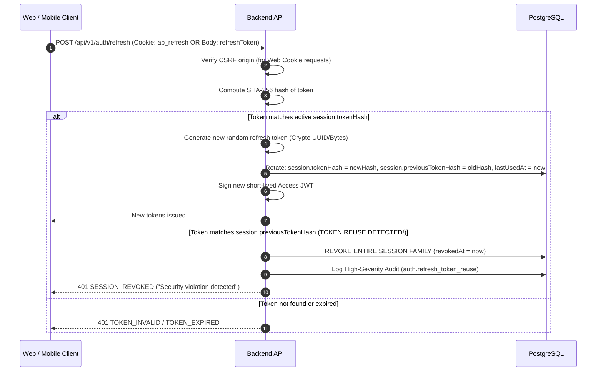

# Authentication and Authorization Architecture

This document provides a comprehensive guide to the authentication, session lifecycle, role-based access control, security invariants, and regulatory compliance of the **Auto Poster Advertising Platform**.

---

## 1. Authentication Flows

The platform implements distinct, role-tailored authentication pipelines designed for security, convenience, and low friction.

### 1.1 Driver Passwordless Flow (Mobile App)

Auto-rickshaw drivers use mobile numbers exclusively. There are no passwords. The same endpoint handles both first-time account registration and subsequent logins.



---

### 1.2 Company Registration and Login Flow (Web Portal)

Companies sign up using work email, phone, and password. To prevent spam and fake accounts, mobile verification via OTP is required before dashboard access.



---

### 1.3 Admin 2-Step Verification & Forced Password Change (Web Portal)

Admin accounts (`SUPER_ADMIN`, `MODERATOR`, `FINANCE`) are strictly internal and cannot be self-registered. They require two-step verification (Email/Password + Mobile SMS Challenge).



---

### 1.4 Token Refresh, Rotation, and Reuse Detection

Refresh tokens use sliding-window rotation. Each refresh token can be used **exactly once**.



---

## 2. Account Status Lifecycle Matrix

The platform enforces account status checks uniformly across HTTP endpoints and background jobs:

| Status | DRIVER Capabilities | COMPANY Capabilities | ADMIN Capabilities |
| :--- | :--- | :--- | :--- |
| **`PENDING`** | Can sign in, view status banner, submit KYC documents and vehicle details. Cannot accept campaigns or log daily photos. | Can sign in, view status banner, complete company profile and submit GST/KYC. Cannot launch campaigns or escrow payments. | Can sign in, but forced to change temporary password if `mustChangePassword=true`. |
| **`APPROVED`** | Full access: browse campaigns, stick posters, upload daily GPS verification photos, request printing & rent payouts. | Full access: create campaigns, fund escrow payments, approve installation proofs, review driver daily performance. | Full operational access according to assigned role permissions (`SUPER_ADMIN`, `MODERATOR`, `FINANCE`). |
| **`SUSPENDED`** | Read-only access: can view profile, earnings, and past history. All write operations are blocked with HTTP 403 `ACCOUNT_SUSPENDED`. | Read-only access: can view campaigns and invoices. Cannot create new campaigns or make deposits. | Blocked from performing administrative approvals or modifying settings. |
| **`BLOCKED`** | Denied access at login. All active sessions immediately revoked. Cannot sign in or access any APIs (HTTP 403 `ACCOUNT_BLOCKED`). | Denied access at login. All active sessions immediately revoked. Cannot sign in or access any APIs (HTTP 403 `ACCOUNT_BLOCKED`). | Denied access at login. All active sessions immediately revoked. |

---

## 3. Token & Cookie Architecture

### 3.1 Access Token (JWT)
- **Library**: `jose` (zero-dependency, modern Web Crypto standard).
- **Algorithm**: `HS256` with rotating secret key (`JWT_ACCESS_SECRET`, min 32 chars).
- **Lifetime**: Configurable (`JWT_ACCESS_TTL`, default `15m`).
- **Standard Claims**:
  ```json
  {
    "sub": "usr_9b1deb4d-3b7d-4bad-9bdd-2b0d7b3dcb6d",
    "sid": "ses_5f3b7b6e-1d2a-4c8e-9b3a-8f9d7e6c5b4a",
    "role": "COMPANY",
    "jti": "5a4b3c2d-1e0f-4a5b-8c7d-9e0f1a2b3c4d",
    "iat": 1740000000,
    "exp": 1740000900
  }
  ```

### 3.2 Refresh Token & Cookie Storage
- **Format**: 64-character cryptographically secure hex string (`crypto.randomBytes(32)`).
- **Storage in DB**: Stored as SHA-256 hash (`tokenHash`). The raw token is never persisted.
- **Web Delivery**: Stored in a secure `httpOnly` cookie:
  - `Name`: `ap_refresh`
  - `Path`: `/api/v1/auth/refresh` (restricted scope to prevent leakage on standard API calls)
  - `HttpOnly`: `true` (inaccessible to JavaScript / XSS)
  - `SameSite`: `Lax`
  - `Secure`: `true` in production (requires HTTPS)
  - `Domain`: Configurable via `COOKIE_DOMAIN` (e.g. `.autoposter.com` or omitted for host-only)
- **Mobile Delivery**: Returned in JSON response body (`refreshToken`), persisted by the mobile app in hardware-backed storage (`expo-secure-store` on iOS Keychain / Android Keystore).

### 3.3 CSRF Protection
Cookie-based refresh requests are defended with Origin & Custom Header verification:
1. `Origin` or `Referer` must match `WEB_ORIGINS` allow-list.
2. In SPA fetch clients, `x-requested-with: XMLHttpRequest` is validated when origins are ambiguous.

---

## 4. Security Controls & Invariants

### 4.1 Argon2id Password Hashing
- **Algorithm**: Argon2id (`argon2` package).
- **Parameters**:
  - Memory cost: `65536` KB (64 MB)
  - Time cost: `3` iterations
  - Parallelism: `1` thread
  - Salt length: `16` random bytes
- **Anti-Enumeration Timing Protection**: When a non-existent email is supplied at login, a dummy Argon2id hash check is performed using a pre-computed constant hash to eliminate timing discrepancies between existing and non-existing accounts.

### 4.2 Account Lockout Protection (Redis)
- **Max Consecutive Failures**: Configurable via `LOGIN_MAX_FAILURES` setting (default `5`).
- **Lockout Duration**: Configurable via `LOGIN_LOCK_MINUTES` setting (default `15` minutes).
- **Key Schema**: `lockout:email:<normalized_email>` (counter) and `lockout:active:<normalized_email>` (flag).
- **Reset**: Cleared automatically upon any successful password login.

### 4.3 OTP Rate Limiting & Cooldowns
- **IP Rate Limit**: 25 requests per hour per IP address in Redis (`rl:otp:ip:<ip>`).
- **Resend Cooldown**: Configurable via `OTP_RESEND_COOLDOWN_SECONDS` (default `30s`, `0s` in test mode).
- **Daily Target Cap**: Maximum 10 verification OTPs per mobile/email per rolling 24 hours (`OTP_DAILY_LIMIT_PER_TARGET`).
- **Max Verification Attempts**: 5 failed code submissions per OTP request (`OTP_MAX_ATTEMPTS`). Exceeding this invalidates the OTP immediately.

### 4.4 Temporary Password Policy (Admin Team)
- Generated with `crypto.randomBytes(9)` (12 characters, upper/lower/numbers/symbols).
- Mandatory `mustChangePassword = true` flag set upon account creation.
- Web Admin layout forces redirect to `/admin/change-password` if flag is active.

---

## 5. Role Permissions Reference Matrix

The platform seeds 14 granular permissions across operational domains:

| Permission Key | Description | SUPER_ADMIN | MODERATOR | FINANCE | COMPANY | DRIVER |
| :--- | :--- | :---: | :---: | :---: | :---: | :---: |
| `campaigns.create` | Create new advertising campaigns | Yes | No | No | **Yes** | No |
| `campaigns.approve` | Approve or reject pending campaigns | **Yes** | **Yes** | No | No | No |
| `users.approve` | Approve driver / company KYC profiles | **Yes** | **Yes** | No | No | No |
| `photos.verify` | Approve or reject daily driver verification photos | **Yes** | **Yes** | No | No | No |
| `payouts.approve` | Approve printing allowances & driver rent payouts | **Yes** | No | **Yes** | No | No |
| `payouts.process` | Execute bank / gateway payout batches | **Yes** | No | **Yes** | No | No |
| `disputes.resolve` | Review and resolve disputed daily photo rejections | **Yes** | **Yes** | No | No | No |
| `strikes.manage` | Issue or revoke penalty strikes against drivers | **Yes** | **Yes** | No | No | No |
| `settings.edit` | Modify platform settings & business parameters | **Yes** | No | No | No | No |
| `team.manage` | Invite, update roles, or suspend admin staff | **Yes** | No | No | No | No |
| `audit.view` | Inspect platform audit logs and security events | **Yes** | **Yes** | **Yes** | No | No |
| `reports.view` | Access financial statements and analytics | **Yes** | No | **Yes** | No | No |
| `daily_photos.upload` | Upload daily installation/GPS verification photos | No | No | No | No | **Yes** |
| `escrow.fund` | Deposit advance escrow funds for campaigns | No | No | No | **Yes** | No |

---

## 6. DLT SMS Compliance (Indian Telecom Operators)

Under Telecom Regulatory Authority of India (TRAI) regulations, all SMS messages dispatched to Indian phone numbers must comply with Distributed Ledger Technology (DLT) rules.

### 6.1 Regulatory Identifiers
- **Principal Entity (PE) ID**: Enterprise registration number with telecom operator (e.g., Airtel, Jio, Vodafone-Idea DLT portals).
- **Sender ID / Header**: 6-character alphabetic header assigned to the brand (e.g., `AUTOPT` or `APOSTR`). Must be prefixed or suffixed with operator code by the carrier.
- **Route Type**: **Service Implicit** / **Transactional** (24/7 delivery without DND restrictions).

### 6.2 Pre-Approved SMS Templates

#### Template 1: Login / Driver Authentication
- **Template ID**: `DLT_TMPL_AUTH_OTP_01`
- **Registered Format**:
  ```
  Your Auto Poster verification code is {#var#}. Valid for {#var#} minutes. Do not share this code with anyone. - Auto Poster
  ```
- **Constraints**:
  - Variable 1: 6-digit numeric OTP code.
  - Variable 2: Numeric TTL in minutes (e.g. `5`).

#### Template 2: Admin Two-Factor Authentication
- **Template ID**: `DLT_TMPL_ADMIN_2FA_02`
- **Registered Format**:
  ```
  {#var#} is your 2-step verification code for Auto Poster Admin Portal. Valid for {#var#} minutes. - Auto Poster
  ```
- **Constraints**:
  - Variable 1: 6-digit numeric OTP code.
  - Variable 2: `5` minutes.

#### Template 3: Company Registration Verification
- **Template ID**: `DLT_TMPL_REG_VERIFY_03`
- **Registered Format**:
  ```
  Welcome to Auto Poster! Your mobile verification code is {#var#}. Valid for {#var#} minutes. - Auto Poster
  ```
- **Constraints**:
  - Variable 1: 6-digit numeric OTP code.
  - Variable 2: `5` minutes.

### 6.3 Development & Staging SMS Provider
In non-production environments (`NODE_ENV != 'production'`), the platform defaults to `SMS_PROVIDER=dev`, which formats and outputs verification codes directly into the secure console logger and allows the standard dev bypass code (`123456`) when `OTP_DEV_BYPASS_CODE` is set.
Startup will **strictly fail** if `SMS_PROVIDER=dev` or `OTP_DEV_BYPASS_CODE` are detected in production.

