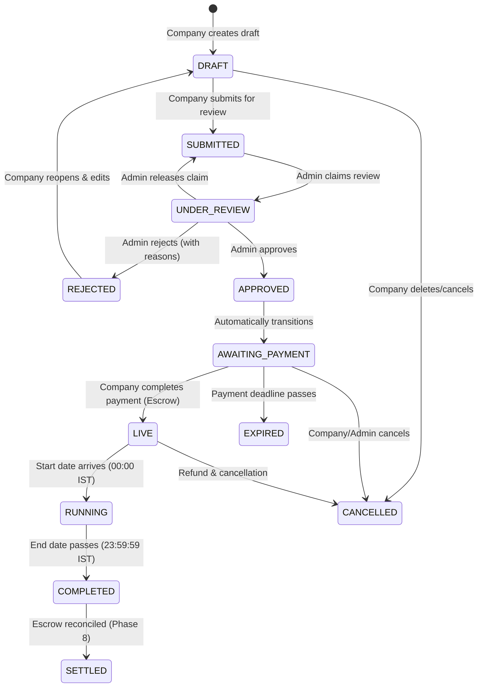

# Campaign Module Architecture & Specification

## 1. Overview & Business Model

The **Campaign Module** is the core marketplace engine where companies order poster advertising on auto-rickshaws.
A campaign specifies:
- **Target Location**: City and specific Zones
- **Target Vehicles**: Auto-rickshaws (`AUTO_RICKSHAW`)
- **Capacity (Slots)**: Number of unique auto-rickshaws requested (e.g., 5 to 500)
- **Duration**: Active advertising period (e.g., 15 to 90 days)
- **Poster Creative**: High-resolution print-ready artwork adhering to safety and content regulations
- **Pricing & Earnings**: Rent per auto per 30 days and printing allowance per auto

Money is stored exclusively in **integer paise** (`BigInt` for totals/escrow/charges, `Int` for per-unit rates).
All calendar dates (`startDate`, `endDate`) operate strictly in **Asia/Kolkata (IST)** date boundaries, while audit timestamps (`createdAt`, `liveAt`, `approvedAt`) are UTC ISO 8601 strings.

---

## 2. Campaign Lifecycle & State Machine

### State Definitions
1. **DRAFT**: Editable by company. Poster upload, dates, zones, and rent can be configured freely.
2. **SUBMITTED**: Locked for edits. Waiting in the admin review queue.
3. **UNDER_REVIEW**: Claimed by a moderator/admin. Exclusive lock prevents reviewer collision.
4. **REJECTED**: Poster or campaign details violate policy. Returned to company with specific rejection codes and reviewer notes. Reopening moves it back to `DRAFT`.
5. **APPROVED / AWAITING_PAYMENT**: Approved by admin. Payment deadline is set (`min(now + payment_deadline_days, startDate - min_payment_lead_days)`).
6. **LIVE**: Payment received in escrow. Visible on the driver mobile app for slot discovery and selection (Phase 6).
7. **RUNNING**: Campaign advertising period has started. Daily photo verification and GPS tracking active.
8. **COMPLETED**: Campaign duration concluded. Pending final payout settlement.
9. **SETTLED**: Financial ledger finalized and drivers fully paid.
10. **EXPIRED**: Awaiting payment deadline elapsed without payment. Released.
11. **CANCELLED**: Terminated before or during run.

---

## 3. Financial Calculations & Pricing Engine

All calculations strictly use `calculateCampaignPricing` from `@ap/shared-constants/money`.

### Formulas
Let:
- $S$: Target auto count (`slots`)
- $D$: Duration in days ($\text{diffDaysIST}(\text{startDate}, \text{endDate}) + 1$)
- $R_{30}$: Rent per 30 days per auto in paise (`rentPer30DaysPaise`)
- $A$: Printing allowance per auto in paise (`printingAllowancePaise`)
- $C_{bps}$: Platform commission basis points (default: 2000 bps = 20.00%)
- $G_{bps}$: GST basis points (default: 1800 bps = 18.00%)

1. **Rent per auto for campaign**:
   $$R_{\text{auto}} = \text{roundHalfUp}\left(\frac{R_{30} \times D}{30}\right) = \left\lfloor \frac{R_{30} \times D + 15}{30} \right\rfloor$$
2. **Total driver rent**:
   $$\text{driverRentTotalPaise} = R_{\text{auto}} \times S$$
3. **Total printing allowance**:
   $$\text{driverPrintingTotalPaise} = A \times S$$
4. **Total driver budget (held in Escrow)**:
   $$\text{totalBudgetPaise} = \text{driverRentTotalPaise} + \text{driverPrintingTotalPaise}$$
5. **Platform commission fee**:
   $$\text{platformFeePaise} = \text{roundHalfUp}\left(\frac{\text{driverRentTotalPaise} \times C_{bps}}{10000}\right)$$
   *(Note: Commission applies only to rent, never to driver printing allowance).*
6. **GST Amount**:
   $$\text{gstAmountPaise} = \text{roundHalfUp}\left(\frac{\text{platformFeePaise} \times G_{bps}}{10000}\right)$$
7. **Total amount charged to company**:
   $$\text{totalChargedPaise} = \text{totalBudgetPaise} + \text{platformFeePaise} + \text{gstAmountPaise}$$

---

## 4. IST Calendar Dates vs UTC Timestamps

| Field | Type | Timezone | Meaning |
|---|---|---|---|
| `startDate` | Date (at 00:00:00 IST) | IST | First day the poster is displayed on autos |
| `endDate` | Date (at 23:59:59.999 IST) | IST | Last day the poster is displayed on autos |
| `createdAt` | DateTime | UTC | System timestamp when record was created |
| `approvedAt` | DateTime | UTC | System timestamp when admin approved |
| `paymentDeadlineAt`| DateTime | UTC | Exact moment payment must be completed by |
| `liveAt` | DateTime | UTC | Timestamp when campaign became discoverable |

All date manipulations (diffs, lead time checks, day additions) use `todayIST()`, `startOfISTDay()`, `endOfISTDay()`, and `diffDaysIST()`.

---

## 5. Poster Content Policy & Admin Review

Poster submissions must adhere to the platform safety guidelines:
1. **Safety & Legality**: No obstruction of rickshaw driver visibility, headlights, or number plates. No illegal, prohibited, or hate speech content.
2. **Resolution & Print Quality**: Minimum resolution (1200px width), approved material (`VINYL_STICKER`, `FLEX`), and explicit print dimensions.
3. **Queue Claiming**: Reviewers claim campaigns from the unassigned review queue. To prevent collision, reviewers cannot claim more than 1 campaign concurrently unless released or decided.

### Rejection Reasons (`CampaignReviewReason`)
- `POSTER_CONTENT_POLICY`: Violates adult, offensive, or prohibited goods policy.
- `POSTER_LOW_QUALITY`: Resolution too low for physical vinyl printing.
- `POSTER_MISLEADING`: Misleading claims or unverified credentials.
- `PRICE_TOO_LOW`: Below platform minimum or uncompetitive.
- `DETAILS_UNCLEAR`: Insufficient print or placement instructions.
- `UNSUPPORTED_AREA`: Selected zones cannot fulfill required auto count.
- `START_DATE_TOO_SOON`: Start date violates minimum lead time requirements.
- `OTHER`: Custom note provided by reviewer.

---

## 6. Concurrency & Slot Allocation (`SlotsService`)

To prevent overbooking when hundreds of drivers simultaneously accept a high-paying campaign:
1. **Pessimistic Row Locking (`SELECT FOR UPDATE`)**:
   Enrolment queries lock the specific `Campaign` row inside a database transaction.
2. **Atomic Verification**:
   Checks `enrolledCount < targetAutoCount` and campaign status `LIVE`.
3. **Strict Increment & Rollback**:
   Increments `enrolledCount` in the same locked transaction. If an assignment fails or is cancelled, `releaseSlot` atomically decrements `enrolledCount`.

---

## 7. Scheduled Jobs (BullMQ / Cron)

| Job Name | Schedule | Action |
|---|---|---|
| `processCampaignStart` | Daily at 00:01 IST (`31 18 * * *` UTC) | Transitions `LIVE` campaigns whose `startDate <= todayIST()` to `RUNNING`. |
| `processCampaignComplete` | Daily at 23:59 IST (`29 18 * * *` UTC) | Transitions `RUNNING` campaigns whose `endDate < todayIST()` to `COMPLETED`. |
| `processPaymentExpiry` | Hourly | Transitions `AWAITING_PAYMENT` campaigns past `paymentDeadlineAt` to `EXPIRED`. |

---

## 8. Handoff Contracts

### For Phase 6: Driver Campaign Selection & Daily Verification
- **Discovery Endpoint**: `GET /api/v1/driver/campaigns` filters campaigns by driver's city and active zones, returning only `LIVE` campaigns with open slots (`enrolledCount < targetAutoCount`).
- **Enrolment**: Driver selects campaign -> calls `SlotsService.reserveSlot(campaignId, driverId, vehicleId)` which locks the campaign and creates an `Assignment` in `ENROLLED` status.
- **Rules**: Drivers can view full specs, poster preview, earnings breakdown, and printing instructions.

### For Phase 8: Escrow Payments & Ledger
- **Payment Initiation**: Uses `campaign.totalChargedPaise` for the gateway order amount.
- **Webhook Bridge**: When payment is captured by Razorpay/Stripe, invokes `CampaignPaymentBridge.markPaid(campaignId, paymentRef)` to credit the escrow ledger and transition the campaign to `LIVE`.

