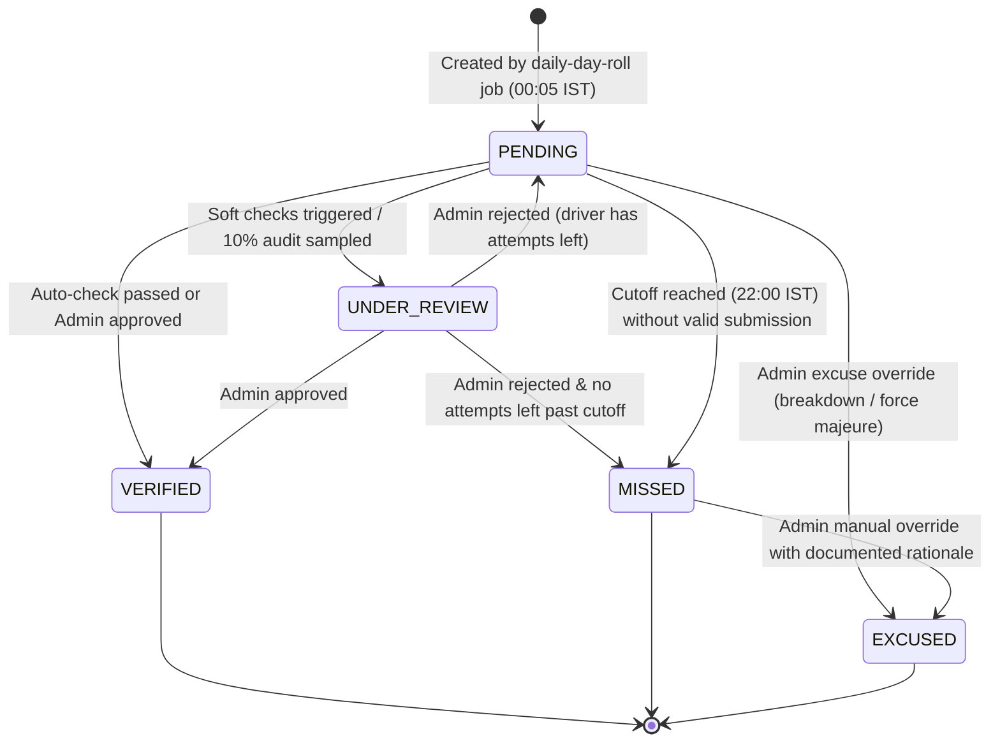

# Daily Photo Proof and Fraud Checks Architecture

## 1. Overview & Purpose

The Daily Photo Proof system ensures that auto-rickshaws assigned to active campaigns continue to display approved, undamaged posters on their registered vehicles every day throughout the campaign duration.

### Core Principles
1. **Live Daily Proof**: Every RUNNING assignment requires at least one live photo proof per day between 06:00 and 22:00 IST.
2. **Instant Auto-Verification**: Clean photos that pass all hard and soft checks are immediately marked `VERIFIED`, updating driver earnings estimates in real time.
3. **Automated Risk Scoring & Routing**: Photos failing soft checks or flagged by fraud heuristics are scored and automatically routed to the Admin Manual Review queue without blocking the driver's workflow.
4. **Fairness & Grace Days**: Missing a daily photo marks that day as `MISSED`, but platform grace days (`grace_days = 3`) forgive initial missed days before deductions apply to final settlement.
5. **Strict Advertiser Privacy**: Advertisers (companies) receive transparent campaign progress metrics, zone performance, and a photo gallery, but driver identities, mobile numbers, and exact GPS coordinates are masked (~110m fuzzy resolution).

---

## 2. Assignment Day Lifecycle

Each day of an active assignment is tracked in the `AssignmentDay` model with the following lifecycle:

### Day States
- **PENDING**: Awaiting driver submission for the current IST day.
- **UNDER_REVIEW**: A photo has been submitted and is currently in the admin manual review queue.
- **VERIFIED**: Photo approved (auto or manual). Day counts towards payable rent.
- **MISSED**: No photo submitted before the daily 22:00 IST cutoff, or all attempts rejected.
- **EXCUSED**: Day excused by an authorized Administrator due to mechanical failure, garage maintenance, or force majeure. Counts towards payable rent.

---

## 3. Automated Inspection Pipeline

Every uploaded daily photo passes through a synchronous two-tier inspection pipeline before queue placement or verification:

### Tier 1: HARD Rejections (Zero Attempts Consumed)
If any hard check fails, the API responds with HTTP 400 and an error code. No attempt counter is deducted from the driver's daily allowance of 5:
1. **Exact Duplicate SHA-256 (`DUPLICATE_PHOTO`)**: The exact image byte hash has already been used in this or any prior assignment.
2. **Mock Location Detection (`PHOTO_MOCK_LOCATION_DETECTED`)**: Client device reported mock GPS or spoofing provider.
3. **Past Daily Cutoff (`PHOTO_PAST_CUTOFF`)**: Capture timestamp or submission time is outside the allowed daily window (after 22:00 IST).

### Tier 2: SOFT Risk Checks (Risk Scored & Attempt Consumed)
Soft checks increment the submission's risk score (0–100). If the cumulative score exceeds threshold (default 25) or the submission is randomly sampled for audit, the photo is marked `MANUAL_REVIEW` and assigned to `AssignmentDay.status = UNDER_REVIEW`:
- **Time of Day (+30 risk)**: Captured outside normal daylight hours (before 06:00 or after 21:00 IST).
- **GPS in Zone (+35 risk)**: Distance from nearest campaign zone exceeds boundary buffer.
- **Near-Duplicate dHash (+40 risk)**: Difference hash Hamming distance $\le 10$ compared against other active vehicles.
- **Stationary Vehicle (+20 risk)**: Consecutive days captured at virtually identical coordinates ($< 25\text{m}$).
- **Clock Skew (+25 risk)**: Difference between client capture timestamp and server receive time exceeds 15 minutes.
- **Device Correlation (+15 risk)**: Same `deviceInstallId` used across multiple driver accounts within 24 hours.

### Random Audit Sampling
- **Base Sampling**: 10% base rate (`audit_sample_percent = 10`).
- **Targeted Multiplier**: Drivers with $\ge 2$ rejected photos in the past 30 days are sampled at 3x the base rate (30%).

---

## 4. Admin Quality Control & Queue Management

### Review Queue
- **Concurrency Locking**: Moderators claim items with a 10-minute TTL lock (`claimedById`, `claimedAt`). If review is not submitted within 10 minutes, the item is automatically returned to the pool.
- **Keyboard Shortcuts**:
  - `[A]`: Instant Approve
  - `[R]`: Open Rejection Dialog
- **Comparison Triad**:
  1. *Submitted Photo*: Today's photo with zoom and overlay.
  2. *Installation Baseline*: Verified poster installation photo on the same auto.
  3. *Previous Day Photo*: Yesterday's verified photo for physical wear and continuity.
- **Rejection Reasons**:
  `PHOTO_UNCLEAR`, `POSTER_NOT_VISIBLE`, `POSTER_REMOVED_OR_DAMAGED`, `WRONG_AUTO`, `WRONG_POSTER`, `PLATE_NOT_VISIBLE`, `LOCATION_MISMATCH`, `OLD_OR_REUSED_PHOTO`, `SCREEN_OR_EDITED_PHOTO`.

### Excuse Day Override
Moderators and Super Admins can manually excuse an unverified or missed day:
- Mandatory justification text (e.g. workshop invoice, mechanic receipt).
- Updates `AssignmentDay` to `EXCUSED` and increments `Assignment.excusedDays`.
- Day becomes payable in the Phase 8 settlement math.

### Role Authorization
- Allowed: `SUPER_ADMIN`, `CITY_ADMIN`, `MODERATOR`.
- **Forbidden**: `FINANCE` role is strictly forbidden from daily photo reviews and fraud overrides.

---

## 5. Company Progress Analytics & Masking

Advertisers view real-time campaign performance while respecting driver privacy:
- **Headline KPIs**: Active Autos, Verified Today %, Campaign Progress %, Total Days Verified, Company Flags.
- **Daily Timeseries**: Stacked status breakdown (`verified`, `underReview`, `missed`) per calendar date.
- **Zone Performance**: Auto counts and verification rates by geographic zone.
- **Privacy Masking**:
  - Vehicle registration masked to prefix and last 4 digits (e.g. `GJ-05-**-1234`).
  - GPS coordinates rounded to 3 decimal places (~110m radius).
  - Driver names and phone numbers are omitted completely.
- **Company Flagging**: Advertisers can flag questionable photos (`POSTER_NOT_VISIBLE`, `WRONG_AUTO`, `LOOKS_FAKE`, `OTHER`), automatically escalating them to admin re-inspection.
- **Direct CSV Export**: `GET /api/v1/company/campaigns/:id/progress.csv` provides date-by-date compliance records.

---

## 6. Scheduled Jobs

1. **`daily-day-roll` (00:05 IST)**: Creates `PENDING` `AssignmentDay` records for all `RUNNING` assignments for the new IST day.
2. **`daily-photo-reminder` (12:00 & 18:00 IST)**: Sends push/SMS reminders to drivers who have not yet submitted proof today.
3. **`missed-day-notice` (22:05 IST)**: Marks all remaining `PENDING` days as `MISSED` and notifies affected drivers.
4. **`daily-review-sla-alert` (Every 30 min)**: Alerts operations management if review queue items remain unreviewed $> 120$ minutes.
5. **`stale-upload-cleanup` (Daily 03:00 IST)**: Deletes unconfirmed temporary uploads older than 24 hours.
6. **Completion Gate Update**: Verifies that all assignment days are finalized before allowing an assignment to complete.

---

## 7. Discipline & Dispute Integration (Phase 9)

Daily photo verifications feed directly into the Phase 9 Discipline & Disputes engine:
1. **Photo Fraud Events**: When a photo fails with high-confidence fraud detection (duplicate byte hash, exact dHash collision, screen capture), a `photo.fraud_suspected` event emits and automatically routes to `StrikeService.handlePhotoFraud()`, issuing a strike under `STRIKE_REASON.FAKE_PHOTO`.
2. **Damaged Poster Notices**: When a photo reveals severe damage or peeling, a 48-hour `PosterFixNotice` is issued, granting the driver a cure window before an automatic strike.
3. **Driver Disputes**: Drivers can dispute rejected photos directly from the mobile app. Filing a dispute places an automatic hold on the assignment's pending payout until resolved by a platform moderator.

