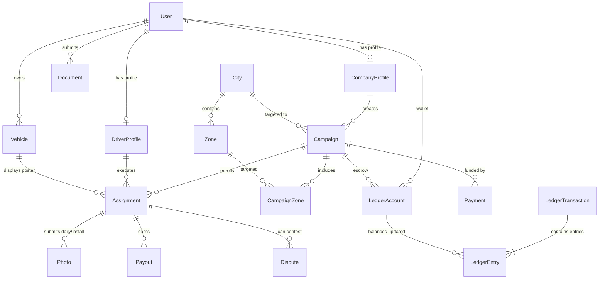
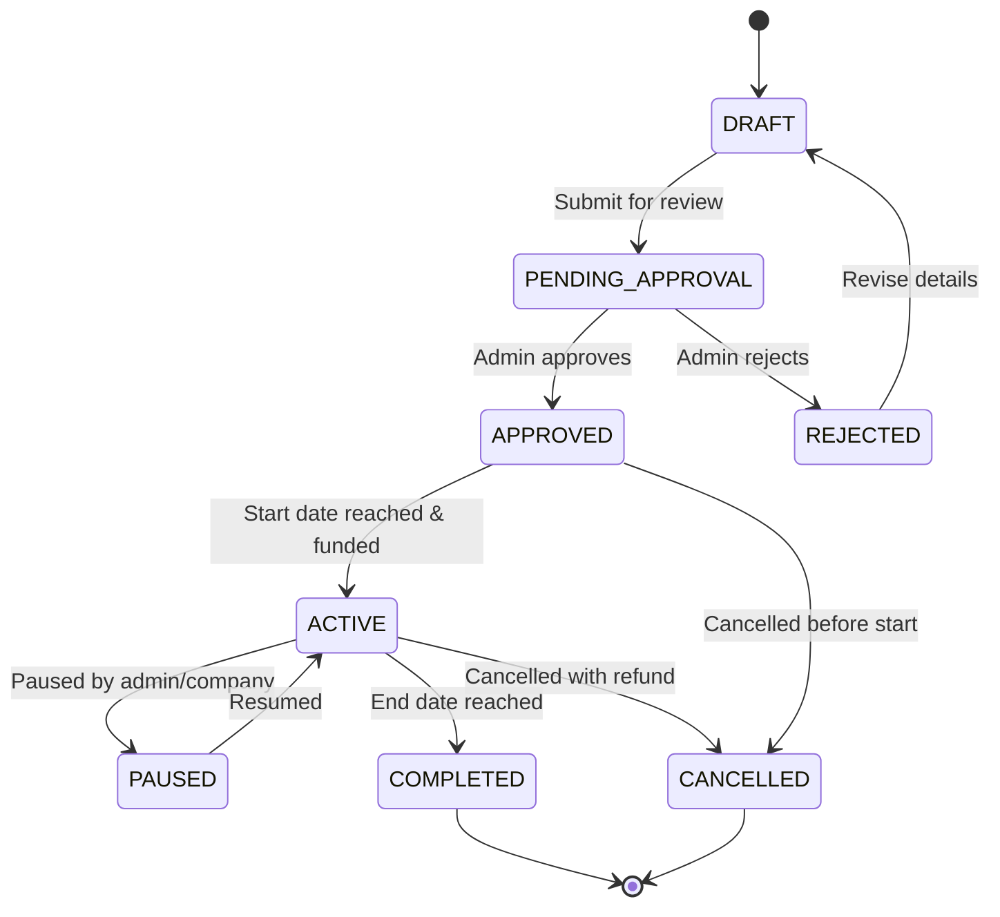
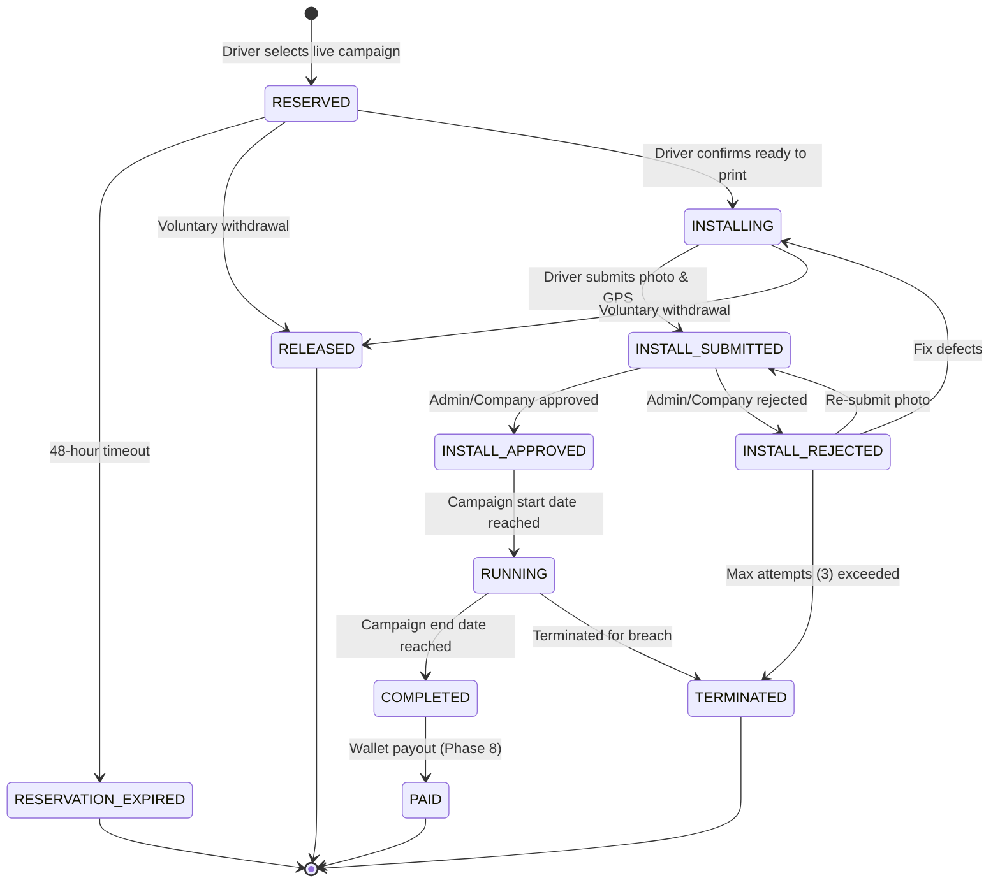
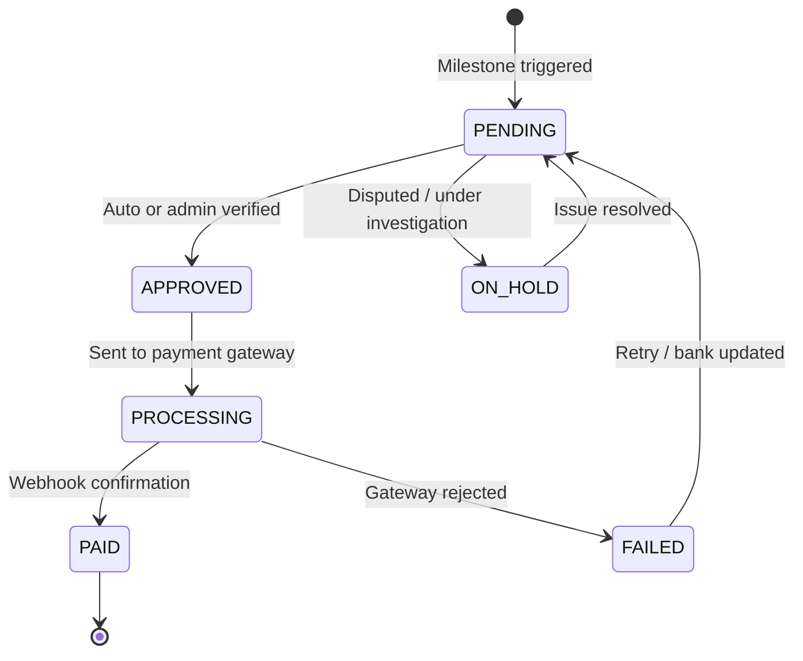

# Database & Core Backend Architecture

This document describes the database design, schema models, constraints, double-entry financial ledger, state machines, seed scripts, and migration workflows for the Auto Poster Advertising Platform.

---

## 1. Overview & Principles

- **Engine**: PostgreSQL 16+ via Prisma ORM.
- **Naming Conventions**:
  - Tables and columns use `snake_case` in the physical database via Prisma `@map` and `@@map`.
  - Prisma models and fields use `PascalCase` and `camelCase` in TypeScript.
  - Primary keys are UUID v4 (`@default(uuid())`).
  - Standard audit timestamps: `createdAt` (`created_at`) and `updatedAt` (`updated_at`) on all mutable entities. Immutable audit/ledger records omit `updatedAt`.
- **Soft Delete Policy**:
  - Soft delete (`deletedAt` / `deleted_at`) is **strictly limited to `User` and `Campaign`**.
  - All other business entities are permanent or archived via status transitions.
  - Queries filter active records via `deletedAt: null` (encapsulated in `notDeletedClause()`).
- **Money Representation**:
  - Zero floating-point numbers. All monetary amounts are stored as **integer paise** (1 INR = 100 paise).
  - Per-unit configuration values (e.g. daily rent rate, printing allowance) are stored as standard `Int` (up to ~2.14 crore paise / ₹2,14,748).
  - Cumulative totals, payments, payouts, and ledger entries use `BigInt` (mapped to PostgreSQL `BIGINT`).
  - Safe serialization: a central JSON prototype override (`apps/api/src/shared/money`) serializes all `BigInt` values as strings before transmission over HTTP.
- **Strict Enum Parity**:
  - All 26 database enums in `schema.prisma` mirror `@ap/shared-constants` identically.
  - An automated CI test (`apps/api/src/__tests__/enums-sync.test.ts`) verifies parity across every enum key and value.

---

## 2. Entity Relationship Overview

The core business flow connects advertisers (companies) to campaigns, auto-rickshaw drivers (assignments), daily verification photos, payouts, and the underlying double-entry ledger.



---

## 3. Schema Catalog (29 Tables)

### Location
| Table | Model | Purpose & Key Relations |
|---|---|---|
| `cities` | `City` | Master list of supported Indian cities. Unique `(name, state)`. Linked to zones and campaigns. |
| `zones` | `Zone` | Geographic operating zones within a city. Stores `center_lat`, `center_lng`, and `radius_meters` for circular bounding GPS validation. Linked to `City`. |

### Identity & Access
| Table | Model | Purpose & Key Relations |
|---|---|---|
| `users` | `User` | Core account model (DRIVER, COMPANY, ADMIN, SUPER_ADMIN). Stores mobile (unique), email (unique), password hash, language, theme, 2FA status, verification timestamps (`mobile_verified_at`, `email_verified_at`), and password flags (`must_change_password`, `password_changed_at`). Supports soft deletion (`deleted_at`). |
| `permissions` | `Permission` | Granular permission keys (`CAMPAIGN_CREATE`, `PAYOUT_APPROVE`, etc.). |
| `role_permissions` | `RolePermission` | Join table binding user roles to specific permission keys. |
| `sessions` | `Session` | Refresh tokens and active authentication sessions. Stores token hash, expiry, IP, and user agent. Cascade deletes on user removal. |
| `otp_requests` | `OtpRequest` | One-time password tracking for authentication, registrations, and sensitive payout adjustments. Tracks attempts, expiry, and consumption. |

### Profiles & Verification
| Table | Model | Purpose & Key Relations |
|---|---|---|
| `company_profiles` | `CompanyProfile` | Company details: legal name, brand name, GSTIN (15 chars), contact person, address, website. Belongs to `User`. |
| `driver_profiles` | `DriverProfile` | Driver details: driving license number (unique), badge number, UPI ID, bank account/IFSC (encrypted via AES-256-GCM), emergency contact. Belongs to `User`. |
| `vehicles` | `Vehicle` | Auto-rickshaws registered by drivers. Stores registration number (unique), make, model, year, RC number, and verification status. Linked to `User` and `Assignment`. |
| `documents` | `Document` | KYC and compliance uploads (DRIVING_LICENCE, VEHICLE_RC, GST_CERTIFICATE, etc.). Stores file URL, MIME type, status, and rejection reason. Linked to `User`. |

### Campaigns & Operations
| Table | Model | Purpose & Key Relations |
|---|---|---|
| `campaigns` | `Campaign` | Poster campaigns created by companies. Stores dates, target vehicle count, verified vehicle count, daily rent per auto, printing allowance per auto, commission percentage, total budget, poster creative URLs, and campaign status. Soft deletable. |
| `campaign_zones` | `CampaignZone` | Many-to-many join table between `Campaign` and `Zone`. |
| `assignments` | `Assignment` | Contract linking a driver and vehicle to a campaign. Tracks status (`RESERVED`, `INSTALLING`, `INSTALL_SUBMITTED`, `INSTALL_APPROVED`, `INSTALL_REJECTED`, `RUNNING`, `COMPLETED`, `PAID`, `RELEASED`, `RESERVATION_EXPIRED`, `TERMINATED`), `releaseReason`, `releasedAt`, `installAttempts`, `extraAttemptsGranted`, `reviewOwner`, `escalatedAt`, `reviewClaimedById`, `reviewClaimedAt`, `windowDays`, and `reservedIdempotencyKey`. Partial unique index guarantees at most one active campaign per vehicle. |
| `photos` | `Photo` | Proof of performance uploads: INSTALLATION or DAILY photos. Stores image URL, thumbnail, GPS coordinates (`lat`, `lng`), capture timestamp, accuracy, status, review notes, daily sequence date (`photo_date`), `attemptNo`, `dhash` (64-bit Sharp perceptual difference hash), `duplicateFlags` (Hamming distance match info), and `reviewReasonCodes`. |

### Financial & Ledger
| Table | Model | Purpose & Key Relations |
|---|---|---|
| `payments` | `Payment` | Company campaign funding payments. Stores order ID, gateway payment ID, amount (paise), payment method, status, and failure reason. Linked to `Campaign` and `User`. |
| `payouts` | `Payout` | Disbursals to drivers (PRINTING_ALLOWANCE, RENT, ADJUSTMENT). Stores amount (paise), method, recipient details, status, gateway reference, and failure reason. Linked to `Assignment` and `User`. |
| `ledger_accounts` | `LedgerAccount` | Chart of accounts: user driver wallets, company refund balances, campaign escrow accounts, platform revenue, and GST payable. |
| `ledger_transactions` | `LedgerTransaction` | Immutable transaction headers grouped by idempotency key. Reference types include CAMPAIGN_PAYMENT, RENT_PAYOUT, COMMISSION, GST, etc. |
| `ledger_entries` | `LedgerEntry` | Double-entry journal entries (`DEBIT` / `CREDIT`). Enforced append-only with strict balance invariants. |

### Governance, Auditing & Communication
| Table | Model | Purpose & Key Relations |
|---|---|---|
| `disputes` | `Dispute` | Driver or company dispute tickets (e.g. photo wrongfully rejected, payment issue). Linked to `Assignment`, `Photo`, and `User`. |
| `strikes` | `Strike` | Disciplinary infractions issued to drivers (fake GPS, damaged poster, missed days). Tracks strike count, active status, and expiry. |
| `audit_logs` | `AuditLog` | Immutable security audit trail recording actor, action, entity, IP, user agent, and redaction-sanitized state diffs (`old_values`, `new_values`). |
| `system_settings` | `SystemSettings` | Dynamic configuration key-value store (pricing, payouts, timeouts, feature flags). Value stored as JSON with Zod validation. |
| `notifications` | `Notification` | Multi-channel user notifications (PUSH, SMS, EMAIL, IN_APP) with delivery status tracking. |
| `notification_templates` | `NotificationTemplate` | Reusable notification templates per event code with multi-lingual body formatting. |
| `device_tokens` | `DeviceToken` | Push notification device registration tokens (FCM/APNS) for mobile devices. |

---

## 4. Lifecycle State Machines

All status transitions are governed by pure state machine graphs (`apps/api/src/shared/state-machine`) that validate valid next states and throw typed `InvalidStateTransitionError` on illegal mutations.

### 4.1 Campaign Lifecycle


### 4.2 Assignment Lifecycle


### 4.3 Payout Lifecycle


---

## 5. Money Rules & Mathematical Formulas

### 5.1 Storage & Units
1. **Never use floating point numbers** for financial data.
2. All figures in code, database, and calculations are in **integer paise** (1 INR = 100 paise).
3. JSON output automatically serializes `BigInt` as string via `apps/api/src/shared/money`.

### 5.2 Campaign Pricing Formula
Given:
- Target vehicle count: $V$
- Total campaign days: $D$ (inclusive: $\text{endDate} - \text{startDate} + 1$)
- Daily rent per auto: $R_{\text{daily}}$ (paise)
- Printing allowance per auto: $A_{\text{print}}$ (paise)
- Platform commission percentage: $P_{\text{comm}}$ (e.g. 15%)
- GST percentage: $P_{\text{gst}}$ (18%)

Calculations (using round half-up integer arithmetic):
$$\text{rentTotal} = V \times D \times R_{\text{daily}}$$
$$\text{printingTotal} = V \times A_{\text{print}}$$
$$\text{subtotal} = \text{rentTotal} + \text{printingTotal}$$
$$\text{commissionTotal} = \operatorname{round}\left(\frac{\text{rentTotal} \times P_{\text{comm}}}{100}\right)$$
$$\text{taxableAmount} = \text{subtotal} + \text{commissionTotal}$$
$$\text{gstTotal} = \operatorname{round}\left(\frac{\text{taxableAmount} \times P_{\text{gst}}}{100}\right)$$
$$\text{grandTotal} = \text{taxableAmount} + \text{gstTotal}$$

### 5.3 Driver Rent Payout Formula
Given:
- Verified daily photos: $D_{\text{verified}}$
- Total campaign duration: $D_{\text{total}}$
- Daily rent rate: $R_{\text{daily}}$

$$\text{grossRent} = D_{\text{verified}} \times R_{\text{daily}}$$
If $D_{\text{verified}} < D_{\text{total}}$, missed days are unearned and returned to the company refund escrow.

---

## 6. Double-Entry Financial Ledger

The platform enforces strict double-entry bookkeeping for all balance movements. Money is never updated directly in a single row; instead, balanced `DEBIT` and `CREDIT` entries are appended.

### 6.1 Chart of Accounts
| Account Type | Description | Normal Balance |
|---|---|---|
| `PLATFORM_REVENUE` | Platform commission earnings | Credit |
| `GST_PAYABLE` | Collected taxes payable to government | Credit |
| `CAMPAIGN_ESCROW` | Funds held for active campaigns | Credit (Liability) |
| `DRIVER_WALLET` | Driver earnings available for payout | Credit (Liability) |
| `COMPANY_REFUND` | Unused campaign funds due for refund | Credit (Liability) |
| `GATEWAY_CLEARING` | Inbound / outbound gateway transition clearing | Debit / Clearing |
| `ADJUSTMENT` | Manual corrections and reconciliation balance | Balancing |

### 6.2 Standard Transactions
1. **Campaign Funding (Escrow Payment)**:
   - `DEBIT` `GATEWAY_CLEARING` (Grand Total)
   - `CREDIT` `CAMPAIGN_ESCROW` (Rent + Printing allowance)
   - `CREDIT` `PLATFORM_REVENUE` (Commission)
   - `CREDIT` `GST_PAYABLE` (GST)
2. **Printing Allowance Disbursal**:
   - `DEBIT` `CAMPAIGN_ESCROW` (Allowance amount)
   - `CREDIT` `DRIVER_WALLET` (Allowance amount)
3. **Daily / Final Rent Disbursal**:
   - `DEBIT` `CAMPAIGN_ESCROW` (Earned rent)
   - `CREDIT` `DRIVER_WALLET` (Earned rent)
4. **Campaign Refund (Unused Days)**:
   - `DEBIT` `CAMPAIGN_ESCROW` (Unearned rent)
   - `CREDIT` `COMPANY_REFUND` (Refund due)
5. **Driver Bank Payout**:
   - `DEBIT` `DRIVER_WALLET` (Payout amount)
   - `CREDIT` `GATEWAY_CLEARING` (Payout amount)

---

## 7. Raw SQL Database Constraints & Invariants

In addition to Prisma schema definitions, migration `20261029115211_raw_sql_constraints` enforces strict PostgreSQL-level constraints:

### 7.1 CHECK Constraints
- **Campaigns**:
  - `target_vehicles > 0`
  - `verified_vehicles >= 0`
  - `end_date >= start_date`
  - `daily_rent_per_auto > 0`
  - `printing_allowance_per_auto >= 0`
  - `commission_percent >= 0 AND commission_percent <= 100`
  - `total_budget_paise > 0`
- **Payments & Payouts**:
  - `amount_paise > 0`
- **Ledger Entries**:
  - `amount_paise > 0`
- **Assignments**:
  - `verified_days >= 0`
  - `missed_days >= 0`
  - `driver_payout_paise >= 0`
- **Coordinates & Zones**:
  - `lat BETWEEN -90 AND 90`
  - `lng BETWEEN -180 AND 180`
  - `radius_meters > 0`

### 7.2 Partial Unique Indexes
- **Single Active Vehicle Assignment**:
  `uniq_active_vehicle_assignment` prevents any vehicle from holding more than one active assignment across `APPLIED`, `SELECTED`, `POSTER_ASSIGNED`, `INSTALL_PENDING`, `INSTALL_VERIFIED`, and `ACTIVE` statuses.
- **One Verified Photo Per Assignment Per Day**:
  `uniq_verified_daily_photo` ensures no assignment can have more than one `APPROVED` photo on any calendar `photo_date`.
- **Assignment Day Per Calendar Date**:
  `assignment_days` enforces a composite unique constraint on `(assignment_id, date)` guaranteeing one tracking record per assignment per IST calendar day.
- **Unique Scoped Ledger Accounts**:
  `uniq_ledger_user_account` and `uniq_ledger_campaign_account` enforce one account per type per user/campaign.

### 7.3 Append-Only DB Triggers
PostgreSQL triggers raise hard exceptions on any `UPDATE` or `DELETE` statement executed against:
- `ledger_transactions`
- `ledger_entries`
- `audit_logs`

### 7.4 Deferrable Constraint Trigger
The `trg_ledger_entries_balanced` constraint trigger runs on `COMMIT` of any transaction involving `ledger_entries`. It computes $\sum \text{debits} - \sum \text{credits}$ across all transactions touched in that commit and raises an exception if the difference is non-zero (`LEDGER_UNBALANCED`).

---

## 8. Seed Data Guide

### 8.1 Base Seed (`pnpm db:seed:base`)
- **Safety**: Safe to run in production; completely idempotent (`upsert` only).
- **Contents**:
  - All standard permissions (`CAMPAIGN_CREATE`, `CAMPAIGN_APPROVE`, `PAYOUT_APPROVE`, etc.).
  - Default role-permission mappings for `SUPER_ADMIN`, `ADMIN`, `COMPANY`, and `DRIVER`.
  - Default system settings (`pricing.commission_percent`, `payout.min_withdrawal_paise`, etc.).
  - System chart of accounts (`PLATFORM_REVENUE`, `GST_PAYABLE`, `GATEWAY_CLEARING`, `ADJUSTMENT`).
  - Default Super Admin account:
    - Mobile: `+919999999999`
    - Email: `superadmin@autoposter.com`
    - Password: `AdminPassword123!`

### 8.2 Demo Seed (`pnpm db:seed:demo`)
- **Safety**: **Development and staging environments only**.
- **Contents**:
  - 3 Cities (Ahmedabad, Surat, Vadodara) with geographic zones.
  - 2 Verified Companies (Amul India, Havmor Ice Cream).
  - 5 Verified Drivers with auto-rickshaws (RJ/GJ registrations) and KYC documents.
  - Active campaigns, poster assignments, daily GPS photos, and fully balanced ledger funding transactions.
- **Demo Logins (Password for all: `DemoPassword123!`)**:
  - Super Admin: `+919999999999` (`superadmin@autoposter.com`)
  - Admin: `+919888888888` (`admin@autoposter.com`)
  - Company 1: `+919876543210` (`campaigns@amul.coop`)
  - Company 2: `+919876543211` (`marketing@havmor.com`)
  - Driver 1: `+919123456780`
  - Driver 2: `+919123456781`
  - Driver 3: `+919123456782`

---

## 9. Running Tests

### Prerequisites
PostgreSQL and Redis services must be running:
```bash
docker compose -f infra/docker/docker-compose.yml up -d
```

### Running Test Suites
```bash
# Run all unit and integration tests across monorepo
pnpm test

# Run API unit and database integration tests only
pnpm --filter @ap/api test
```

### Test Database Isolation
Integration tests execute against `autoposter_test` (port 5432) defined in `.env.test`. Before test runs, migrations are executed against this dedicated test database to preserve development data in `autoposter_dev`.

---

## 10. Database Migration Runbook

When introducing schema modifications:

1. **Modify Schema**:
   Edit `apps/api/prisma/schema.prisma`.
2. **Generate Migration**:
   ```bash
   pnpm --filter @ap/api prisma migrate dev --name <descriptive_name> --create-only
   ```
3. **Review & Add Constraints**:
   Review the generated SQL file in `apps/api/prisma/migrations/`. Add any custom check constraints or triggers if required.
4. **Apply Migration**:
   ```bash
   pnpm --filter @ap/api prisma migrate dev
   ```
5. **Verify Enum Synchronization**:
   If enums were modified, ensure `@ap/shared-constants` is updated and run:
   ```bash
   pnpm --filter @ap/api test src/__tests__/enums-sync.test.ts
   ```
6. **Verify Clean Seed**:
   Test on a fresh database:
   ```bash
   pnpm --filter @ap/api db:seed:base
   pnpm --filter @ap/api db:seed:demo
   ```

---

## 11. Discipline, Disputes and Notifications Schema (Phase 9)

Phase 9 added models, relations, and indexes supporting compliance enforcement, dispute resolution, and cross-channel messaging:

### 11.1 Discipline & Compliance Models
- **`Strike`**: Stores driver strikes (`FAKE_PHOTO`, `POSTER_REMOVED`, `DAMAGED_POSTER_EXPIRED`, `OTHER`), reason details, evidence relations, active status, and revocation timestamps with admin audit FK.
- **`DriverBan`**: Tracks temporary (e.g. 90-day ladder trigger) and permanent bans (`TEMPORARY`, `PERMANENT`), effective dates, lifting timestamps, and administering staff user IDs.
- **`PosterFixNotice`**: 48-hour cure window for torn or peeling creatives before an automated strike is issued.

### 11.2 Disputes & Claims Models
- **`Dispute`**: Tracks disputes filed by drivers or companies against assignments, campaigns, photos, or settlements. Records `heldAmountPaise` (BigInt), status transitions (`OPEN`, `CLAIMED`, `RESOLVED`, `APPEALED`, `CLOSED`), and assigned moderator.
- **`DisputeMessage`**: Threaded discussion between driver/company and platform moderators, with `visibility` (`ALL` vs `ADMIN_ONLY`).
- **`DisputeEvidence`**: File uploads and system logs supporting the claim, with `visibility` control.
- **`DisputeEvent`**: Audit log of dispute lifecycle transitions, SLA escalations, and executed resolution effects.

### 11.3 Notification Platform Models
- **`Notification`**: Persistent in-app messages with category, priority, localized title/body, action URLs, and read receipts (`readAt`).
- **`NotificationPreference`**: Per-user category toggles for push, SMS, and email.
- **`UserNotificationSettings`**: Per-user quiet hours configuration (`quietHoursEnabled`, `quietHoursStart`, `quietHoursEnd`).
- **`Announcement`**: Broadcast platform messages targeted by role, city, or campaign status with live delivery statistics.
- **`DeviceToken`**: Push tokens registered from mobile devices (Android/iOS) with provider (`EXPO`).

