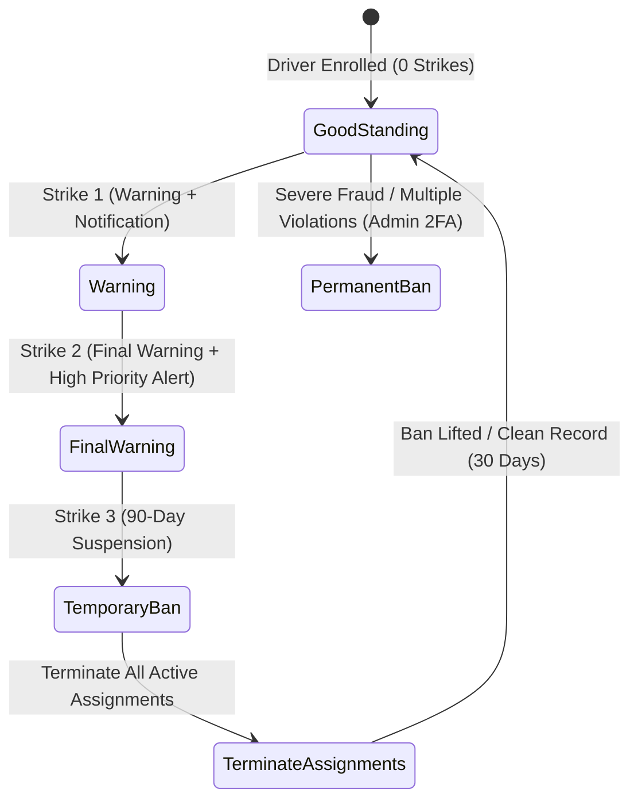
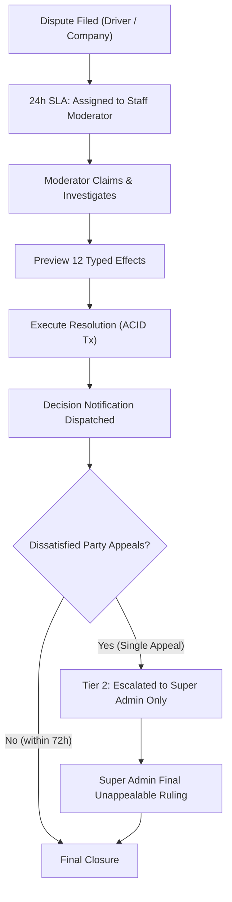

# Discipline, Strikes and Disputes System

## 1. Overview

The Auto Poster platform maintains quality and trust across advertisers, auto-rickshaw drivers, and the platform through two coordinated subsystems:
1. **Discipline & Strikes System**: Enforces compliance (photo verification, poster maintenance, active campaign participation) via a graduated three-strike ladder, poster-fix notices, and automated abandonment termination.
2. **Disputes & Claims System**: Mediates conflicts between drivers and advertisers with strict driver anonymity, financial escrow holds, 12 typed resolution effects executed in database transactions, and two-tier reviews (Staff Moderator -> Super Admin).

---

## 2. Driver Discipline & Strike Ladder

### 2.1 Strike Rules and Causes
A strike is issued to a driver for clear rule violations:
- **Fake or Old Photo**: Submitting duplicate, cropped, screen-captured, or EXIF-manipulated daily photos (`STRIKE_REASON.FAKE_PHOTO`).
- **Missing or Removed Poster**: Operating an auto-rickshaw without the registered campaign creative (`STRIKE_REASON.POSTER_REMOVED`).
- **Damaged or Torn Poster (48-Hour Notice Expiry)**: Failing to replace or repair a damaged poster within 48 hours of platform notice (`STRIKE_REASON.DAMAGED_POSTER_EXPIRED`).
- **Inactivity / Abandonment**: Sustained missing daily photos or unauthorized vehicle switch (`STRIKE_REASON.OTHER`).

### 2.2 Three-Strike Ladder

- **Strike 1 (Warning)**: In-app warning notification, SMS alert, meter advances to 1/3.
- **Strike 2 (Final Warning)**: Urgent warning, priority push notification, meter advances to 2/3.
- **Strike 3 (Automatic 90-Day Ban)**:
  - Account status placed on temporary suspension (`bannedUntil = now + 90 days`).
  - **Immediate termination** of all active assignments in `RESERVED`, `INSTALLING`, `INSTALL_SUBMITTED`, `INSTALL_APPROVED`, and `RUNNING` states.
  - Daily slots freed on respective campaigns, decrementing `enrolledCount`.
  - Notification dispatched to driver and affected campaign companies.
- **Permanent Ban**: Manual admin action with 2FA and audit log. Permanently blacklists the driver's phone, Aadhaar/driving license, and vehicle registration numbers from ever registering again.
- **Clean Record Reset**: If 30 consecutive calendar days pass without any new strike or missed day, active strikes expire and the driver's strike counter resets to 0.

### 2.3 Poster-Fix Notices (48-Hour Cure Window)
When an advertiser or automated quality check detects a peeling, torn, or partially obscured poster:
1. Platform issues a `POSTER_FIX_NOTICE` with deadline set to `now + 48 hours`.
2. Driver receives high-priority notification with instructions to fix or reprint the poster.
3. If driver uploads a verified replacement photo before the deadline, notice is marked `RESOLVED`.
4. If deadline expires without resolution, the system automatically issues a formal strike.

### 2.4 Abandonment Detection
- An hourly job (`discipline-abandonment-check`) inspects all `RUNNING` assignments.
- If an assignment records **7 consecutive missed days**, it is automatically transitioned to `TERMINATED` due to abandonment.
- Slots are freed on the campaign to allow replacement drivers to enroll.

---

## 3. Disputes & Settlement Holds

### 3.1 Filing Disputes
- **Drivers** may dispute:
  - Rejected daily verification photos
  - Missed day penalties
  - Strikes issued
  - Deduction in final settlement
- **Advertisers** may dispute:
  - Creative quality or incorrect placement
  - Driver route shortfall (under min daily km)
  - Poster tampering or unverified days

### 3.2 Strict Privacy Protection (Driver Anonymity)
To protect driver privacy and avoid off-platform harassment:
- Advertisers **never** see driver full names, phone numbers, email addresses, or vehicle registration plates.
- Drivers are presented to companies as masked references (e.g., `Auto #A-4821` or `Driver #D-1092`).
- Dispute message threads have visibility toggles (`ALL` vs `ADMIN_ONLY`): internal admin notes are never exposed to external parties.

### 3.3 Settlement Escrow Holds
When a dispute is opened against an assignment or campaign:
1. `calculateHoldAmount()` calculates the maximum disputed amount in paise:
   - For daily rent disputes: `disputed_days * daily_rent_paise`.
   - For installation disputes: printing allowance (`15000` paise).
   - For campaign-level disputes: up to total unpaid escrow balance.
2. `Dispute.heldAmountPaise` is recorded in the database.
3. The settlement worker (`SettlementHoldProvider.hasActiveHold()`) blocks payout and closeout execution while an active hold exists.
4. On resolution, `releaseHeld()` atomically releases the hold or transfers funds per the decision effect.

---

## 4. 12 Typed Dispute Resolution Effects

Resolutions are previewed with full financial and state diffs, then executed in an ACID database transaction:

| # | Effect | Description | Double-Entry Ledger Impact |
|---|---|---|---|
| 1 | `NONE` | No change in status or payout; dispute closed. | None |
| 2 | `EXCUSE_DAY` | Converts a `MISSED` day to `EXCUSED` with admin note. | Payable to driver ledger |
| 3 | `REJECT_DAY` | Confirms photo rejection and finalizes day as `MISSED`. | Retained in campaign escrow |
| 4 | `APPROVE_PHOTO` | Overrides photo rejection and marks day `VERIFIED`. | Credited to driver payable |
| 5 | `REVOKE_STRIKE` | Revokes an issued strike and updates driver meter. | None |
| 6 | `ISSUE_STRIKE` | Issues a strike against driver for verified bad faith. | None |
| 7 | `PARTIAL_REFUND_COMPANY` | Refunds a specified paise amount from held escrow to company. | `CAMPAIGN_ESCROW` -> `COMPANY_WALLET` |
| 8 | `FULL_REFUND_COMPANY` | Refunds all held escrow paise to company. | `CAMPAIGN_ESCROW` -> `COMPANY_WALLET` |
| 9 | `RELEASE_PAYMENT_DRIVER` | Releases held disputed funds into driver wallet balance. | `CAMPAIGN_ESCROW` -> `DRIVER_PAYABLE` |
| 10 | `SPLIT_ADJUSTMENT` | Proportionally distributes disputed funds between parties. | Balanced split across ledgers |
| 11 | `EXTEND_DEADLINE` | Grants extra campaign runtime or installation hours. | None |
| 12 | `TERMINATE_ASSIGNMENT` | Immediately terminates assignment and adjusts slots. | Settles verified days only |

---

## 5. Two-Tier Review & SLAs

- **SLA Milestones**:
  - `24 Hours`: Warning notification to staff moderator queue.
  - `48 Hours`: Critical escalation badge in admin workspace.
  - `72 Hours`: Auto-routed to Senior Dispute Manager.
- **Second-Level Review (Appeals)**: Either party may file a single appeal within 72 hours of initial decision. Second-level reviews can **only** be claimed and ruled on by users with `SUPER_ADMIN` role.

