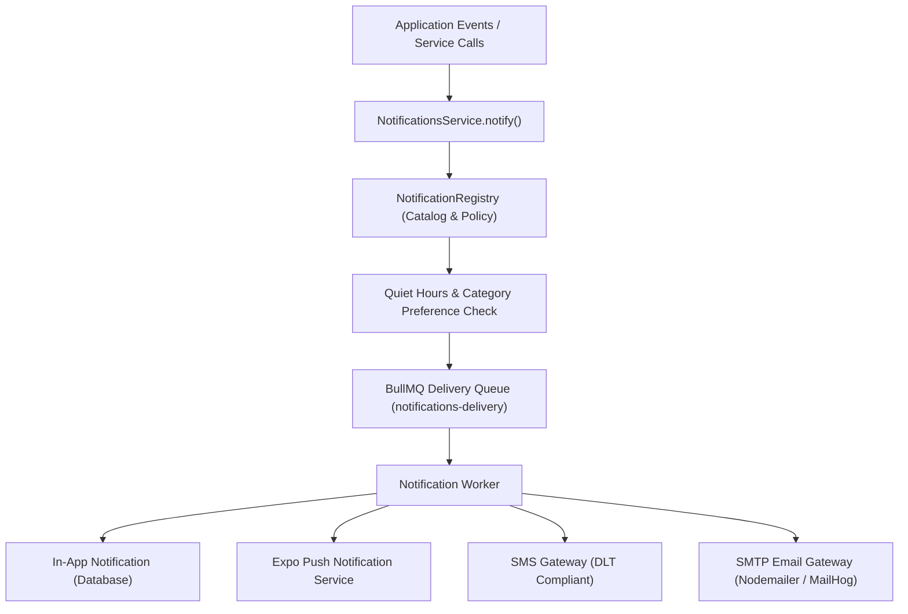

# Notification Platform Architecture

## 1. Overview

The Auto Poster Notification Platform provides multi-channel, localized, and priority-aware message delivery across drivers, advertising companies, and platform administrators.

---

## 2. Notification Registry & Channels

Every notification in the system is defined as a strongly typed key in `NotificationRegistry` (`notification.registry.ts`), with defined default priority, channel routing, and user subscription permissions:

### 2.1 Notification Categories
- `DISCIPLINE`: Strike notices, suspension alerts, poster repair deadlines (**Mandatory** — cannot be unsubscribed).
- `DISPUTES`: Filing receipts, evidence updates, moderator rulings, appeal status.
- `FINANCE`: Payout disbursements, wallet credits, payment receipts, escrow refunds.
- `CAMPAIGN`: Assignment reservations, installation approvals, deadline reminders.
- `SYSTEM`: Security alerts, password resets, platform announcements (**Mandatory** for critical security).

### 2.2 Channel Strategy
| Channel | Destination | Primary Use Cases |
|---|---|---|
| **In-App** | Database (`Notification` table) | Persistent inbox, unread badges, audit record across all roles. |
| **Push** | Mobile devices via Expo Push API | Time-sensitive driver notifications (photo reminder, strike warning). |
| **SMS** | Mobile phone via DLT Provider | OTP login, security alerts, high-urgency discipline warnings. |
| **Email** | SMTP / MailHog | Invoices, payment receipts, monthly tax summaries, dispute reports. |

---

## 3. Quiet Hours & Delivery Capping

### 3.1 Quiet Hours
- Configured by default for Indian Standard Time: **22:00 to 07:00 IST**.
- During quiet hours:
  - `URGENT` priority notifications (e.g., OTPs, account bans, emergency recalls) bypass quiet hours immediately.
  - `NORMAL` and `LOW` notifications are delayed or routed solely to in-app delivery without firing loud push or SMS alarms.

### 3.2 Daily Push Capping
- To prevent driver notification fatigue, daily caps are enforced per category (default: max 5 announcements/marketing push messages per 24-hour rolling window).
- Transactional and discipline notifications are exempt from daily caps.

---

## 4. Multi-Channel Dispatchers

### 4.1 In-App Notification Center
- Stored directly in the `Notification` PostgreSQL table.
- Dynamically rendered in driver mobile app and web portals using `@ap/shared-i18n` dictionary strings (supporting English, Hindi, and regional languages).
- Optimistic read receipt tracking: `markAsRead()` and `markAllRead()`.

### 4.2 Expo Push Notifications
- Mobile drivers register their Expo push tokens via `POST /api/v1/auth/device-token`.
- Tokens are stored in `DeviceToken` with platform (`ANDROID` / `IOS`) and provider `EXPO`.
- Push payloads are batched (up to 100 receipts per request) via `expo-server-sdk`.
- Delivery receipts are periodically verified; invalid tokens (`DeviceNotRegistered`) are automatically pruned.

### 4.3 DLT-Compliant SMS Gateway
- Telecom Commercial Communications Customer Preference Regulations (TCCCPR) compliant.
- Integrates with registered DLT entity and header templates (`SMS_PROVIDER=dev` in local testing, logging formatted frames to console).

### 4.4 Email Gateway
- Configured via `nodemailer` using environment credentials (`SMTP_HOST`, `SMTP_PORT`, `SMTP_USER`, `SMTP_PASS`).
- Local development automatically routes emails to MailHog (`localhost:1025`, web view at `localhost:8025`).

---

## 5. Broadcast Announcements & Admin Digest

### 5.1 Admin Announcement Composer
- Platform administrators can compose broadcasts targeted by:
  - Target Role (`DRIVER`, `COMPANY`, `ALL`)
  - Geographic City (`BANGALORE`, `MUMBAI`, `DELHI`, etc.)
  - Campaign Status
- Broadcasts are dispatched asynchronously in batches of 250 recipients to prevent database connection spikes.
- Admins can track real-time delivery metrics: `SENT`, `DELIVERED`, `READ`, `FAILED`.

### 5.2 Daily Admin Digest
- A daily cron job (`admin-digest-cron`) aggregates platform statistics at 08:00 IST:
  - New disputes opened and SLA escalation counts
  - Active driver strikes and bans issued
  - Escrow amounts held and settled
- Automatically formatted and dispatched to all `SUPER_ADMIN` and `ADMIN` inboxes.

