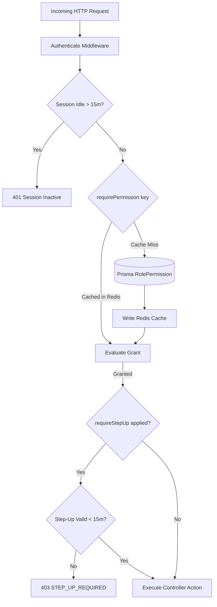

# Platform Roles & Permissions Reference

This document serves as the single source of truth for administrative and platform security roles, permission keys, sensitivity levels, and maker-checker requirements across the **Auto Poster Advertising Platform**.

---

## 1. Overview of Roles

The platform enforces Role-Based Access Control (RBAC) with dynamic permission matrices:

| Role | Target Persona | Scope & Responsibilities |
| :--- | :--- | :--- |
| **SUPER_ADMIN** | Platform Operations Executives | Full unrestricted platform administration. Manages staff credentials, reviews maker-checker sensitive settings, and audits compliance. Privileges are **immutable by design**. |
| **MODERATOR** | Daily Operations & Review Staff | Verifies driver KYC documents, reviews campaign creatives, verifies daily photo proofs, and resolves dispute tickets. |
| **FINANCE** | Accounting & Treasury Ops | Oversees escrow accounts, reconciles payment gateway transactions, manages ledger adjustments, and authorizes payout batches. |
| **COMPANY** | Advertisers / Brands | Self-service advertiser portal to launch campaigns, track fleet verification, and deposit escrow funds. |
| **DRIVER** | Auto-Rickshaw Partners | Mobile driver app to reserve campaigns, submit photo proofs, and withdraw rental earnings. |

---

## 2. Security Safeguards

1. **Step-Up Authentication (2FA)**: High-risk administrative actions (e.g. lifting bans, releasing payouts, editing permission matrices, revealing masked PII) require step-up authentication via SMS OTP or Email challenge with a 15-minute verification window.
2. **Maker-Checker Dual Authorization**: Changes to critical platform parameters (commission fee %, GST rate, auto-flagging risk thresholds) cannot be applied by a single admin. The creator submits a `SettingChangeRequest`, and an independent checker must approve it with Step-Up verification.
3. **Immutable Audit Trail**: Every sensitive state change, PII reveal, or permission update generates a tamper-evident audit record with actor ID, IP address, and shallow diff.
4. **Session Idle Timeout**: Admin sessions expire automatically after **15 minutes** of inactivity to mitigate unattended terminal risks.

---

## 3. Permissions Matrix Reference

### KYC & Onboarding

| Permission Key | Description | Super Admin | Moderator | Finance | Step-Up Required |
| :--- | :--- | :---: | :---: | :---: | :---: |
| `kyc.view` | Inspect driver identity documents, RC, DL, and bank passbooks. | ✅ | ✅ | ❌ | No |
| `kyc.approve` | Review and verify or reject driver onboarding submissions with reason codes. | ✅ | ✅ | ❌ | No |

### Campaigns

| Permission Key | Description | Super Admin | Moderator | Finance | Step-Up Required |
| :--- | :--- | :---: | :---: | :---: | :---: |
| `campaign.view` | Browse advertiser campaigns, budgets, creative designs, and targets. | ✅ | ✅ | ✅ | No |
| `campaign.approve` | Approve or reject advertising campaign designs and print instructions. | ✅ | ✅ | ❌ | No |

### Installations

| Permission Key | Description | Super Admin | Moderator | Finance | Step-Up Required |
| :--- | :--- | :---: | :---: | :---: | :---: |
| `installation.view` | Inspect auto-rickshaw poster installation verification photos. | ✅ | ✅ | ❌ | No |
| `installation.approve` | Approve poster mount quality or reject with damage/obscured reason codes. | ✅ | ✅ | ❌ | No |

### Daily Photos

| Permission Key | Description | Super Admin | Moderator | Finance | Step-Up Required |
| :--- | :--- | :---: | :---: | :---: | :---: |
| `photo.view` | Inspect daily proof photos, GPS geofencing, and EXIF timestamps. | ✅ | ✅ | ❌ | No |
| `photo.approve` | Verify auto-flagged, randomly sampled, or company-disputed daily photos. | ✅ | ✅ | ❌ | No |

### Finance

| Permission Key | Description | Super Admin | Moderator | Finance | Step-Up Required |
| :--- | :--- | :---: | :---: | :---: | :---: |
| `payment.view` | Monitor Razorpay payments, gateway orders, and ledger escrow accounts. | ✅ | ❌ | ✅ | No |
| `settlement.view` | Track daily earned rent, held settlements, and commission releases. | ✅ | ❌ | ✅ | No |
| `payout.view` | Inspect driver IMPS/NEFT payout queues and batch progress. | ✅ | ❌ | ✅ | No |
| `payout.approve` | Release batch disbursement of driver rent and printing allowances. | ✅ | ❌ | ✅ | 🔒 Yes |
| `ledger.view` | Audit double-entry ledger transactions, trial balances, and chart of accounts. | ✅ | ❌ | ✅ | No |

### Disputes & Discipline

| Permission Key | Description | Super Admin | Moderator | Finance | Step-Up Required |
| :--- | :--- | :---: | :---: | :---: | :---: |
| `dispute.view` | Read company and driver dispute tickets, evidence, and messages. | ✅ | ✅ | ✅ | No |
| `dispute.resolve` | Issue binding dispute judgments with rent reallocations and strike actions. | ✅ | ✅ | ❌ | No |
| `strike.manage` | Apply driver strikes, bans, and early assignment terminations. | ✅ | ✅ | ❌ | 🔒 Yes |

### Team & Security

| Permission Key | Description | Super Admin | Moderator | Finance | Step-Up Required |
| :--- | :--- | :---: | :---: | :---: | :---: |
| `team.manage` | Create admin operators, assign staff roles, and suspend credentials. | ✅ | ❌ | ❌ | 🔒 Yes |
| `role.manage` | Configure permission assignments for Moderator and Finance roles. | ✅ | ❌ | ❌ | 🔒 Yes |

### Compliance & Audit

| Permission Key | Description | Super Admin | Moderator | Finance | Step-Up Required |
| :--- | :--- | :---: | :---: | :---: | :---: |
| `audit.view` | Browse tamper-evident logs, shallow diffs, and actor IP addresses. | ✅ | ❌ | ✅ | No |

### Reporting

| Permission Key | Description | Super Admin | Moderator | Finance | Step-Up Required |
| :--- | :--- | :---: | :---: | :---: | :---: |
| `report.view` | Inspect city rollups, revenue metrics, and fleet utilization stats. | ✅ | ✅ | ✅ | No |
| `report.export` | Queue and download raw CSV reports with audit logging. | ✅ | ❌ | ✅ | No |

### Settings & Policy

| Permission Key | Description | Super Admin | Moderator | Finance | Step-Up Required |
| :--- | :--- | :---: | :---: | :---: | :---: |
| `settings.view` | Read system configuration keys, money rates, and thresholds. | ✅ | ✅ | ✅ | No |
| `settings.update` | Modify parameters or submit maker-checker change requests. | ✅ | ❌ | ❌ | No |
| `settings.approve` | Act as the checker to verify and apply sensitive setting modifications. | ✅ | ❌ | ❌ | 🔒 Yes |
| `legal.manage` | Draft and publish Terms of Service, Privacy, and mandate re-consent. | ✅ | ❌ | ❌ | 🔒 Yes |
| `help.manage` | Author and organize knowledge base guides and onboarding FAQs. | ✅ | ✅ | ❌ | No |

### System & Operations

| Permission Key | Description | Super Admin | Moderator | Finance | Step-Up Required |
| :--- | :--- | :---: | :---: | :---: | :---: |
| `system.view` | Monitor PostgreSQL, Redis, disk, memory, and job execution logs. | ✅ | ❌ | ❌ | No |
| `system.manage` | Restart failed background jobs and force daily analytics aggregation. | ✅ | ❌ | ❌ | 🔒 Yes |

---

## 4. Evaluation Architecture

