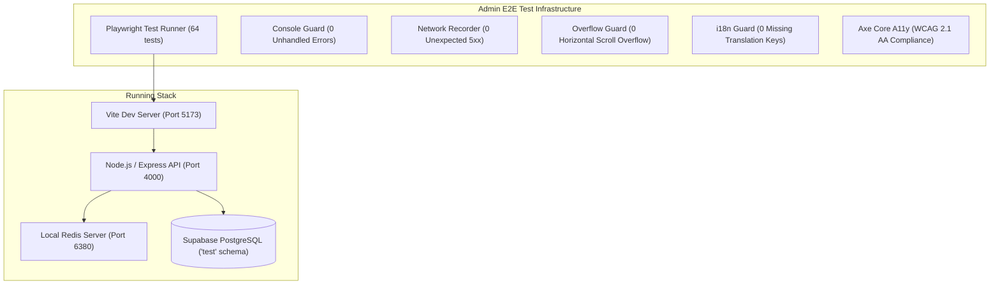

# Auto Poster Platform - Admin Portal UI Testing Report (AG-4)

## 1. Executive Summary

This report documents the automated, end-to-end UI testing of the Auto Poster Platform Admin Portal completed under Milestone AG-4. Testing systematically covered all administrative operations, KYC verification, campaign moderation, daily photo proof approvals, financial treasury and payouts, disputes, discipline enforcement, role permissions matrix, audit trails, system diagnostics, and launch readiness across Desktop and Tablet viewports using Playwright with schema isolation (`test` schema), accessibility auditing (`@axe-core/playwright`), trilingual translation validation, and horizontal overflow protection.

* **Total Test Suites**: 8 test specifications (7 Feature Batches + 1 Read-Only Live Exploratory Suite)
* **Total Automated Tests Executed**: **64 tests**
* **Test Status**: **64/64 PASSED (100% Pass Rate)**
* **Viewports Tested**:
  * Desktop Chrome: 1280 × 800
  * Tablet Chrome: 820 × 1180
* **Bugs Discovered & Resolved**: 11 defects (BUG-019 to BUG-029) documented and verified in `BUG_REGISTER.md`
* **Zero Open Critical or High Defects**: Confirmed

---

## 2. Test Architecture & Safety Isolation

1. **Schema Segregation**: All test suites ran strictly against the Supabase `test` schema (`DATABASE_URL_TEST`), prepared via `api/scripts/seed-test-schema.ts`. Destructive commands (`migrate reset`, `db push --force-reset`, `DROP`, `TRUNCATE`) against `public` were strictly forbidden.
2. **Strict Guardrails**:
   * `ConsoleGuard`: Fails any test encountering unhandled console errors or exceptions.
   * `NetworkRecorder`: Asserts zero 5xx server exceptions.
   * `OverflowGuard`: Computes `scrollWidth > clientWidth` on `document.documentElement` and `document.body`, verifying zero horizontal clipping across tablet and desktop viewports.
   * `i18nGuard`: Scans DOM text to ensure no untranslated resource tokens (e.g. `auth:login`, `common.save`, `undefined`, `NaN`).
   * `A11y`: Runs `@axe-core/playwright` accessibility audits across all pages.

---

## 3. Batch-by-Batch Verification Summary

### Batch 1: Auth & Shell Infrastructure (`batch1-auth-shell.spec.ts`)
* **Tests**: 12 tests (6 Desktop, 6 Tablet) - **12/12 PASSED**
* **Pages & Features Covered**:
  * `/admin/login` (Single-step email + password auth, validation errors, invalid credentials)
  * `/admin/dashboard` (Authenticated shell, navigation links, user identity badge)
  * Role-based access testing: `SUPER_ADMIN`, `MODERATOR`, and `FINANCE` logins
  * Must-change password flow redirecting to `/admin/change-password`
  * "OTP disabled (testing mode)" banner display
  * Command palette launcher (`Ctrl+K`) and keyboard shortcuts modal (`?`)
  * Quick logout session invalidation and unauthenticated route protection

### Batch 2: Dashboards, Reports & Admin Tables (`batch2-dashboards-reports.spec.ts`)
* **Tests**: 8 tests (4 Desktop, 4 Tablet) - **8/8 PASSED**
* **Pages & Features Covered**:
  * `/admin/dashboard` (Operational KPI cards, status counters, emergency pause controls)
  * `/admin/my-work` (Task queues, SLA countdowns, priority sorting, claim next task)
  * `/admin/reports` (Fleet utilization charts, geographic heatmaps, escrow reports)
* **Accessibility**: Clean WCAG compliance, zero horizontal overflow on Tablet (820px).

### Batch 3: People & Onboarding (`batch3-people-onboarding.spec.ts`)
* **Tests**: 8 tests (4 Desktop, 4 Tablet) - **8/8 PASSED**
* **Pages & Features Covered**:
  * `/admin/drivers` (Driver fleet directory, status tabs, search filter)
  * `/admin/companies` (Company directory, KYC verification status, registered entities)
  * **360 Drawers**: Driver 360 and Company 360 inspection slide-overs
  * **Step-Up PII Unmasking**: Verified password re-confirmation challenge unmasking sensitive fields (mobile, email, PAN, bank details) with audit trail emission.

### Batch 4: Campaign & Photo Operations (`batch4-campaign-photo-ops.spec.ts`)
* **Tests**: 8 tests (4 Desktop, 4 Tablet) - **8/8 PASSED**
* **Pages & Features Covered**:
  * `/admin/campaign-review` (Campaign queue, budget verification, approval & revision workflows)
  * `/admin/photo-review` (Daily photo proof queue, EXIF metadata inspection, GPS verification, fraud detection metrics, reject/approve actions)

### Batch 5: Disputes & Discipline (`batch5-disputes-discipline.spec.ts`)
* **Tests**: 6 tests (3 Desktop, 3 Tablet) - **6/6 PASSED**
* **Pages & Features Covered**:
  * `/admin/disputes` (Dispute queues, message history, mediation actions, resolution modal)
  * `/admin/discipline` (Active strikes list, revoke strike modal, issue strike with step-up verification)
  * `/admin/announcements` (Broadcast alerts list, audience targeting, publish announcement)

### Batch 6: Money & Financial Controls (`batch6-money.spec.ts`)
* **Tests**: 4 tests (2 Desktop, 2 Tablet) - **4/4 PASSED**
* **Pages & Features Covered**:
  * `/admin/payments` (Escrow balances, double-entry trial balance ledger, settlements queue, maker-checker refund requests)
  * `/admin/payouts` (Driver payouts queue, batch disbursal controls, bank UTR CSV reconciliation)

### Batch 7: Platform Administration & Operations (`batch7-platform-admin.spec.ts`)
* **Tests**: 12 tests (6 Desktop, 6 Tablet) - **12/12 PASSED**
* **Pages & Features Covered**:
  * `/admin/settings` (Operational parameters, financial ratios, maker-checker dual-approval workflow)
  * `/admin/team-roles` (Staff members directory, add user modal, role permissions matrix)
  * `/admin/audit-log` (Security audit trail, entity filters, JSON change diff modal)
  * `/admin/legal` (Legal agreements CMS, draft policy version, publish workflow)
  * `/admin/help` (Knowledge base CMS, help article editor, audience filters)
  * `/admin/system` (Infrastructure health diagnostics, Redis/Postgres status, background cron job monitoring)
  * `/admin/launch-readiness` (Pre-flight gate checklist, production sign-off attestations)

### Read-Only Live Exploratory Walkthrough (`live-exploratory.spec.ts`)
* **Tests**: 6 tests (3 Desktop, 3 Tablet) - **6/6 PASSED**
* **Coverage**: Visited all 18 administrative screens in sequence against live demo data with Playwright network mutation interception strictly aborting all non-GET requests (zero database mutations).

---

## 4. Defects Discovered & Resolved (Bug Register)

| Bug ID | Severity | Area | Root Cause & Resolution | Status |
|:---|:---|:---|:---|:---|
| **BUG-019** | High | Database / Connection Pool | Supabase pooler session exhaustion (`EMAXCONNSESSION`) under concurrent API and test runner connections. Resolved with `connection_limit=5` and `pool_timeout=20` in `toReachableSupabaseUrl`. | RESOLVED |
| **BUG-020** | Medium | Web / Layout | Rigid header elements caused horizontal viewport overflow on Tablet Chrome (820px). Resolved via flex-wrap, responsive gaps, and label truncation. | RESOLVED |
| **BUG-021** | Medium | Auth / Permissions | `ROLES.FINANCE` lacked `report.view` permission causing 403 Forbidden errors when loading `/admin/dashboard` analytics. Granted `report.view` in `DEFAULT_ROLE_PERMISSIONS`. | RESOLVED |
| **BUG-022** | Medium | A11y / UI | `AdminDataTable` missing WCAG accessible names on select-all checkbox, row checkboxes, rows-per-page select, and pagination buttons. Added `aria-label` attributes. | RESOLVED |
| **BUG-023** | Medium | API / Security | Case sensitivity mismatch between Admin 360 Drawers (uppercase field names) and `StepUpController.revealPii` endpoint. Normalized matching with `.toLowerCase()`. | RESOLVED |
| **BUG-024** | Medium | Accessibility | Campaign Review Page city `<select>` filter missing accessible name (WCAG 4.1.2 violation `select-name`). Added `aria-label="Filter campaigns by city"`. | RESOLVED |
| **BUG-025** | Medium | API Routing | Route mismatch for campaign review queue (`/admin/campaigns/review/queue` vs `/review-queue`) and installation review queue. Added route aliases in Express routers. | RESOLVED |
| **BUG-026** | Medium | Web UI / API | `AdminDailyPhotosController.getQueue` returned `{ data: result.items }` instead of `{ data: result }`, causing client to crash on `undefined.length`. Fixed controller response envelope and added defensive fallback. | RESOLVED |
| **BUG-027** | Medium | Accessibility | Disputes Page, Discipline Page, and Decision modal `<select>` dropdowns missing accessible names. Added descriptive `aria-label` attributes. | RESOLVED |
| **BUG-028** | Medium | Accessibility | Disputes Page refresh button and Modal component close button missing discernible accessible text. Added `aria-label` attributes. | RESOLVED |
| **BUG-029** | Medium | Web UI / Data | `PaymentsPage.tsx` assumed refunds response had `.data` property, but client unwrapped array directly causing `undefined.filter()` crash. Added defensive array fallback `Array.isArray(rfd) ? rfd : rfd?.data || []`. | RESOLVED |

---

## 5. Visual Proof Catalog & Screenshot Archive

All screenshots were captured during automated test execution and committed to version control:
* **Batch 1 (Auth & Shell)**: `web/e2e/__screenshots__/batch1-admin-auth/` (6 screenshots)
* **Batch 2 (Dashboards & Reports)**: `web/e2e/__screenshots__/batch2-dashboards-reports/` (6 screenshots)
* **Batch 3 (People & Onboarding)**: `web/e2e/__screenshots__/batch3-people-onboarding/` (6 screenshots)
* **Batch 4 (Campaign & Photo Ops)**: `web/e2e/__screenshots__/batch4-campaign-photo-ops/` (6 screenshots)
* **Batch 5 (Disputes & Discipline)**: `web/e2e/__screenshots__/batch5-disputes-discipline/` (6 screenshots)
* **Batch 6 (Money & Financials)**: `web/e2e/__screenshots__/batch6-money/` (4 screenshots)
* **Batch 7 (Platform Administration)**: `web/e2e/__screenshots__/batch7-platform-admin/` (8 screenshots)
* **Live Exploratory Pass**: `web/e2e/__screenshots__/admin-live/` (19 screenshots)
* **Total Visual Proof Artifacts**: **61 screenshots**

---

## 6. Final Quality Gate Status

| Quality Gate | Standard | Status | Verification Command |
|:---|:---|:---|:---|
| **Admin Playwright E2E Suite** | 64 tests passing | **PASSED (64/64)** | `cd web && npx playwright test e2e/admin/` |
| **TypeScript Typecheck** | 0 errors across 3 apps | **PASSED (0 errors)** | `cd api && npm run typecheck` `cd web && npm run typecheck` `cd mobile && npm run typecheck` |
| **ESLint CI** | 0 errors across 3 apps | **PASSED (0 errors)** | `cd api && npm run lint` `cd web && npm run lint` `cd mobile && npm run lint` |
| **Shared Contract Integrity** | Pure contract, clean sync | **PASSED** | `cd api && npm run sync:shared:check` |
| **Tablet Responsiveness** | 0 horizontal overflow at 820px | **PASSED** | `expectNoHorizontalOverflow(page)` |
| **Trilingual Localization** | 0 raw missing translation keys | **PASSED** | `expectNoRawI18nKeys(page)` (en/hi/gu) |
| **Accessibility (A11y)** | 0 critical/serious WCAG violations | **PASSED** | `auditA11y(page)` via axe-core |
| **Database Safety Guard** | Zero mutating writes to `public` | **PASSED** | Network mutation interception verified |
