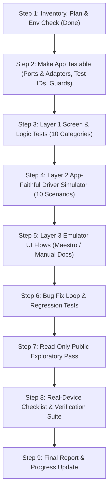

# AG-5 Execution Plan: Driver Mobile App Hardening, Simulator & Verification

**Date:** 2026-11-17  
**Author:** Senior QA Engineer & Full-Stack Developer  
**Status:** In Execution  

---

## 1. Objectives & Boundaries

Milestone **AG-5** hardens and verifies the driver mobile application (`mobile/`) and its associated backend API surfaces (`/api/v1/driver/*`, `/api/v1/uploads/*`, `/api/v1/notifications/*`, `/api/v1/devices/*`).

### Mandatory Boundaries
- **Single Database Instance:** Supabase PostgreSQL development database in `api/.env`.
- **Target Schema for Tests & Simulator:** `test` schema (`DATABASE_URL_TEST`, `cd api && npm run db:test:prepare`).
- **Safety Policy:** `public` schema contains demo data and is **STRICTLY READ-ONLY**. Zero destructive commands, zero migrations.
- **Contract Sync Rule:** Pure shared code lives in `api/src/contract/` only. Synced to `web/` and `mobile/` via `cd api && npm run sync:shared`.
- **Honesty Principle:** Native hardware capabilities (real camera sensor, real physical GPS, real push delivery) are marked as **MANUAL** verification items, never falsely claimed as passed.

---

## 2. Phased Execution Sequence

### Phase Breakdown

1. **Step 1: Inventory & Environment Verification (Complete)**
   - Verified AG-1 to AG-4 complete in `AG_PROGRESS.md`.
   - Recorded toolchain in `MOBILE_ENV_CHECK.md`.
   - Screen matrix established in `MOBILE_SCREEN_INVENTORY.md`.

2. **Step 2: App Testability & Ports/Adapters Integration**
   - Confirm decoupling of offline queue, camera, GPS, device info, clock, secure store, and push notifier behind `container` adapters.
   - Audit test IDs and accessibility labels across interactive controls.
   - Run security invariant guards (no `dev-sim`, no literal `isMockLocation: false`, SecureStore tokens, AdMob placement policy).

3. **Step 3: Layer 1 Screen & Logic Tests (10 Quality Categories)**
   - Category 1: Render States (loading, empty, error, offline, success, locked)
   - Category 2: Data Correctness (integer paise to INR formatting, 4 settlement calculation specs: 30d/100%, 27d/100%, 24d/90%, 15d/60%)
   - Category 3: Forms & Normalization (mobile `+91`, vehicle plate including BH series, UPI ID, IFSC)
   - Category 4: Actions & Error Handling (`OTP_DISABLED`, `SESSION_REVOKED`, double-tap idempotency)
   - Category 5: Navigation & Gating (`resolveEntryRoute` for all 7 account states, deep links)
   - Category 6: Permissions & Native Flows (fine GPS, camera rationale, mock location flag, install ID)
   - Category 7: Offline Queue (persistence, resume across checkpoints, account scoping, cleanup)
   - Category 8: i18n & Theme (en, hi, gu completeness, dark/light contrast)
   - Category 9: Accessibility (touch targets >= 48dp, dynamic font scaling 130%, non-color status)
   - Category 10: Privacy & Security (screen capture prevention, masked bank/UPI, token storage)

4. **Step 4: Layer 2 Driver Simulator (`mobile/tools/driver-sim/`)**
   - 10 scenario groups driven against live API running on Supabase `test` schema:
     1. Registration, Login, Refresh & Password Auth
     2. KYC Onboarding (Personal, Vehicle, Documents, Payout, Consents, Review)
     3. Campaigns Browse, Filter, Detail & Select Reservation
     4. Installation Guide, Artwork Download & Verification Photo Submission
     5. Multi-Day Proof Photos (Verified, Missed, Late grace, Duplicate, Soft-flag review, Projections)
     6. Offline Queue & Resumes (Airplane mode, process kill checkpoints, backoff)
     7. Wallet, Allowance Credit, Rent Settlement, Withdrawal limits & Double-tap
     8. Discipline, Strikes, Ban, Poster Fix Notices & Disputes Appeal Thread
     9. Notifications, Unread Badges, Deep Link Navigation & Device Token Registration
     10. Offers & Local Ads, Frequency Capping & Kill Switch
   - Ledger balance invariant validation after money scenarios (`trialBalance`).
   - Assertion that `public` schema counts are untouched.

5. **Step 5: Layer 3 Emulator UI Flows**
   - Document declarative Maestro flows in `mobile/maestro/*.yaml`.
   - Mark as `needs manual run` per environment check (no active AVD).

6. **Step 6: Bug Register & Regression Fixes**
   - Classify all issues (APP BUG, API BUG, TRANSLATION BUG, A11Y BUG, SPEC GAP).
   - Log into `api/docs/ag/BUG_REGISTER.md`.
   - Fix all Critical and High bugs; verify with regression tests.

7. **Step 7: Read-Only Public Exploratory Pass**
   - Execute read-only node exploration script against dev API on `public` schema.
   - Enforce HTTP mutation blocker (no non-GET requests permitted).
   - Check demo data rendering for all driver personas in `TEST_ACCOUNTS.md`.

8. **Step 8: Real-Device Checklist & Final Verification**
   - Update `api/docs/MOBILE_TEST_PLAN.md` with 1-page printable checklist.
   - Double green test run for anti-flakiness verification.
   - Quality checks: `lint:ci`, `typecheck`, `test`, `sync:shared:check`, `check:boundaries`, `check:env`, `check:secrets`.
   - Expo production bundle export (`npx expo export --platform android`) to measure JS bundle size.
