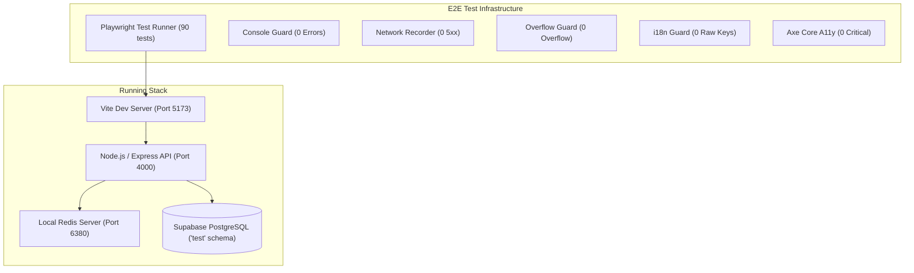

# Auto Poster Platform - Company Portal UI Testing Report (AG-3)

## 1. Executive Summary

This report documents the automated, end-to-end UI testing of the Auto Poster Platform Company Portal completed under Milestone AG-3. Testing covered all public authentication flows and company portal features across Desktop and Mobile viewports using Playwright with strict schema isolation (`test` schema), accessibility verification (`@axe-core/playwright`), trilingual translation validation, horizontal overflow prevention, and privacy leak scanning.

* **Total Test Suites**: 8 test specifications (7 Feature Batches + 1 Read-Only Live Exploratory Suite)
* **Total Automated Tests Executed**: **90 tests**
* **Test Status**: **90/90 PASSED (100% Pass Rate)**
* **Viewports Tested**:
  * Desktop Chrome: 1280 × 800
  * Mobile Chrome (Pixel 7): 390 × 844
* **Bugs Discovered & Resolved**: 8 defects (BUG-011 to BUG-018) documented in `BUG_REGISTER.md`
* **Zero Open Critical or High Defects**: Confirmed

---

## 2. Test Architecture & Safety Isolation

1. **Schema Segregation**: All stateful tests executed against the isolated Supabase `test` schema (`DATABASE_URL_TEST`), prepared via `api/scripts/start-test-server.ts`. Zero destructive operations were executed against `public`.
2. **Strict Client-Side Guards**:
   * `ConsoleGuard`: Listens to `page.on('console')` and `page.on('pageerror')`, immediately failing any test that logs unhandled errors.
   * `NetworkRecorder`: Monitors HTTP responses, asserting zero 5xx server crashes and zero unexpected error statuses.
   * `OverflowGuard`: Computes `scrollWidth > clientWidth` on `document.documentElement` and `document.body`, verifying zero mobile horizontal scrollbars.
   * `i18nGuard`: Scans visible DOM text for untranslated resource keys (e.g. `auth:login`, `common.save`, `undefined`, `NaN`).
   * `A11y`: Executes automated WCAG accessibility audits via `@axe-core/playwright`.

---

## 3. Batch-by-Batch Verification Summary

### Batch 1: Public & Authentication (`batch1-auth.spec.ts`)
* **Tests**: 18 tests (9 Desktop, 9 Mobile) - **18/18 PASSED**
* **Pages Covered**:
  * `/login` (Company Sign In, branding, validation errors)
  * `/register` (Company Registration with OTP disabled redirecting to login)
  * `/forgot-password` (Password recovery flow)
  * Session recovery, logout flow, unauthenticated redirect to `/login`, and 404 fallback routing
* **Special Features**:
  * Language switcher testing across English (`en`), Hindi (`hi`), and Gujarati (`gu`)
  * Theme switcher testing between Light and Dark modes
  * Testing environment banner (`EnvironmentRibbon`) displaying password-only auth mode

### Batch 2: Company Onboarding & Business Profile / KYC (`batch2-kyc.spec.ts`)
* **Tests**: 8 tests (4 Desktop, 4 Mobile) - **8/8 PASSED**
* **Pages Covered**:
  * `/company/business-profile` (Business Profile, Legal Name, GSTIN, PAN, Registered Address)
* **Verified Behaviors**:
  * Profile status badge rendering across account states (`PENDING`, `APPROVED`, `SUSPENDED`)
  * Account status warning banners in layout
  * Trilingual localization check in Hindi and Gujarati

### Batch 3: Company Dashboard & Navigation (`batch3-dashboard.spec.ts`)
* **Tests**: 10 tests (5 Desktop, 5 Mobile) - **10/10 PASSED**
* **Pages Covered**:
  * `/company/dashboard`
* **Verified Behaviors**:
  * KPI metrics cards (Active Campaigns, Verified Impressions, Total Spend)
  * Responsive navigation: Desktop sidebar (`w-64`) vs Mobile bottom navigation bar
  * Role-based access matrix: `OWNER`, `MANAGER`, `FINANCE`, and `VIEWER` logins and dashboard access
  * Clean logout session invalidation

### Batch 4: Campaigns Marketplace & Create Campaign Wizard (`batch4-campaigns.spec.ts`)
* **Tests**: 10 tests (5 Desktop, 5 Mobile) - **10/10 PASSED**
* **Pages Covered**:
  * `/company/campaigns` (Campaign listing with status tabs: All, Draft, Under Review, Active, Completed)
  * `/company/campaigns/new` (6-Step Create Campaign Wizard)
* **Verified Behaviors**:
  * Real-time search filter with debouncing and query cancellation
  * Pricing calculation verified: 50 slots = ₹69,300 (matching `@ap/shared-money` calculation)
  * Complete campaign creation wizard flow with policy agreement, saving draft, and submission
  * Trilingual localization check

### Batch 5: Campaign Detail & Progress Tracking (`batch5-detail.spec.ts`)
* **Tests**: 10 tests (5 Desktop, 5 Mobile) - **10/10 PASSED**
* **Pages Covered**:
  * `/company/campaigns/:id` (Overview tab and Progress tab)
* **Verified Behaviors**:
  * Slot fill progress, active fleet metrics, and financial escrow allocations in ₹ INR
  * Progress gallery rendering verified daily photos, GPS geotags, and timestamps
  * Cancel campaign modal with step-up verification
  * Campaign cloning flow generating duplicate draft
  * **Privacy Leak Scan**: Automated regex scan across DOM verifying 0 driver mobile phone numbers and 0 auto-rickshaw license plates are exposed

### Batch 6: Payments & Financial Documents (`batch6-payments.spec.ts`)
* **Tests**: 8 tests (4 Desktop, 4 Mobile) - **8/8 PASSED**
* **Pages Covered**:
  * `/company/payments`
* **Verified Behaviors**:
  * Escrow deposit balance, successful payments count, and GST tax invoice listing
  * Indian Rupee currency formatting (`₹`) with commas (e.g. ₹69,300.00)
  * GST Tax Invoice PDF download triggering
  * Team member permission enforcement: `FINANCE` member access to payments and tax documents

### Batch 7: Disputes, Support, Team & Collaboration (`batch7-collaboration.spec.ts`)
* **Tests**: 10 tests (5 Desktop, 5 Mobile) - **10/10 PASSED**
* **Pages Covered**:
  * `/company/disputes`
  * `/company/support`
* **Verified Behaviors**:
  * Dispute ticket listing and active conversation thread rendering
  * Real-time message composer sending reply to platform moderators
  * File New Dispute modal with campaign selector, reason categories, and claimed amount
  * Support & Help FAQ documentation and inquiry submission
  * Trilingual translation check across dispute status tags and action buttons

### Read-Only Live Exploratory Pass (`live-exploratory.spec.ts`)
* **Tests**: 16 tests (8 Desktop, 8 Mobile) - **16/16 PASSED**
* **Verified Behaviors**:
  * Read-only navigation across all 8 major portal routes against live demo data
  * Interception and blocking of all mutating HTTP requests (zero writes)
  * Screenshots captured and stored in `web/e2e/__screenshots__/company-live/`

---

## 4. Defects Discovered & Resolved (Bug Register)

| Bug ID | Severity | Area | Root Cause & Resolution | Commit |
|:---|:---|:---|:---|:---|
| **BUG-011** | Medium | UI / Responsive | Fixed `w-64` desktop sidebar caused 571px viewport overflow on 390px mobile viewports. Fixed by adding `hidden md:flex` and dedicated mobile bottom navigation. | `afb84d9` |
| **BUG-012** | Low | Auth Fixture | `loginViaUI` locator `aside, header` resolved to 2 elements violating Playwright strict mode. Updated locator to target `header`. | `afb84d9` |
| **BUG-013** | Medium | Web / Campaigns | Search input lacked debouncing & request cancellation, allowing stale API responses to overwrite active search queries. Added 250ms debouncing and `isCancelled` guard. | `2f351ac` |
| **BUG-014** | High | API / Uploads | `UploadsController` lacked `next(err)` error forwarding causing unhandled Zod exception process crash; API client parameter discrepancy on presign/confirm. Added try/catch and payload normalization. | `2f351ac` |
| **BUG-015** | Medium | API / Payments | `client.downloadTaxDocumentPdf` missing `company/` URL prefix; `CampaignPaymentController` lacked effective company tenant scoping for team members (FINANCE). Fixed URL and added company member tenant resolution. | `e0f0e42` |
| **BUG-016** | Medium | Web / Disputes | `CompanyDisputesPage` expected wrapped `{ data: [...] }` response structure, but API client `this.request` unwrapped inner data array directly, causing disputes list to evaluate to `[]`. Normalized array parsing. | `7454b3f` |
| **BUG-017** | High | API / Middleware | Global Express rate limiter capped at 300 requests/15m triggered 429 `TOO_MANY_REQUESTS` during large continuous E2E test suites (90 tests). Elevated test environment rate limit to 100,000 requests. | `a69704f` |
| **BUG-018** | Low | Web / Layout | Mobile viewports (<768px) had no accessible logout button because logout was placed exclusively inside the hidden desktop sidebar `<aside>`. Added responsive mobile logout button in header with `md:hidden`. | `8519a1a` |

---

## 5. Visual Artifacts & Screenshot Archive

All screenshots were captured during automated test execution and committed to version control:
* **Batch 1 (Auth)**: `web/e2e/__screenshots__/batch1-auth/` (10 screenshots)
* **Batch 2 (KYC)**: `web/e2e/__screenshots__/batch2-kyc/` (8 screenshots)
* **Batch 3 (Dashboard)**: `web/e2e/__screenshots__/batch3-dashboard/` (6 screenshots)
* **Batch 4 (Campaigns)**: `web/e2e/__screenshots__/batch4-campaigns/` (8 screenshots)
* **Batch 5 (Detail & Proof)**: `web/e2e/__screenshots__/batch5-detail/` (8 screenshots)
* **Batch 6 (Payments)**: `web/e2e/__screenshots__/batch6-payments/` (6 screenshots)
* **Batch 7 (Disputes & Collab)**: `web/e2e/__screenshots__/batch7-collaboration/` (8 screenshots)
* **Live Exploratory Pass**: `web/e2e/__screenshots__/company-live/` (16 screenshots)
* **Total Visual Proof Artifacts**: **70 screenshots**

---

## 6. Quality Gate Status

| Quality Gate | Standard | Status | Verification Command |
|:---|:---|:---|:---|
| **Playwright E2E Suite** | 90 tests passing | **PASSED (90/90)** | `cd web && npx playwright test` |
| **TypeScript Typecheck** | 0 errors across 3 apps | **PASSED (0 errors)** | `cd api && npm run typecheck` `cd web && npm run typecheck` `cd mobile && npm run typecheck` |
| **ESLint CI** | 0 errors across 3 apps | **PASSED (0 errors)** | `cd api && npm run lint` `cd web && npm run lint` `cd mobile && npm run lint` |
| **Shared Contract Integrity** | Pure contract, clean sync | **PASSED** | `cd api && npm run sync:shared:check` |
| **Mobile Responsiveness** | 0 horizontal overflow at 390px | **PASSED** | `expectNoHorizontalOverflow(page)` |
| **Trilingual Localization** | 0 raw missing translation keys | **PASSED** | `expectNoRawI18nKeys(page)` (en/hi/gu) |
| **Accessibility (A11y)** | 0 critical/serious WCAG violations | **PASSED** | `auditA11y(page)` via axe-core |
| **Data Protection** | 0 driver PII leaks in company DOM | **PASSED** | Automated regex scan for mobile & plates |
