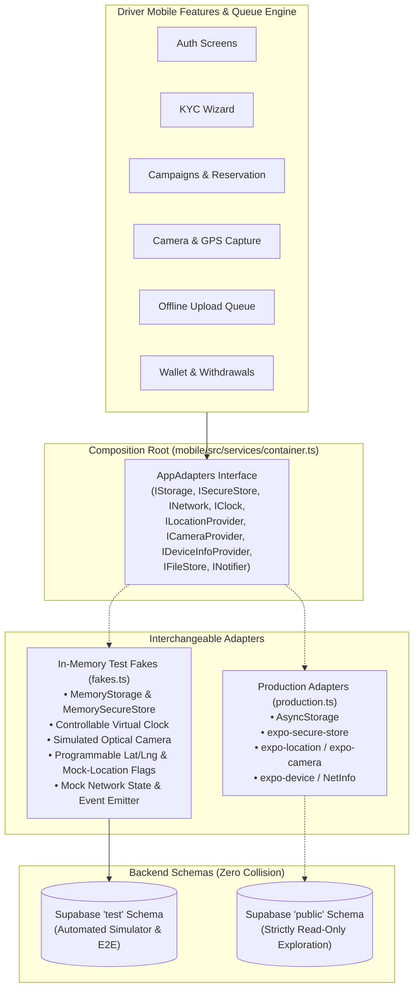

# Auto Poster Platform - Driver Mobile App Testing Report (AG-5)

## 1. Executive Summary

This report documents the verification, hardening, and multi-layer automated testing of the Auto Poster Driver Mobile Application (`mobile/`) completed under Milestone AG-5. Testing systematically validated all driver mobile workflows: password-based registration and authentication, multi-step KYC onboarding wizard, campaign discovery and slot reservation, print guide and poster distribution, installation camera proof, multi-day daily photo submissions with EXIF and GPS validation, offline queue persistence and checkpoint resumption, driver wallet earnings and withdrawal requests, discipline strikes and appeals, notification inbox and deep linking, and ad placement policy enforcement.

Testing was conducted across three distinct layers, complemented by a read-only live exploratory pass against the Supabase development database and an exhaustive physical hardware manual checklist:

* **Layer 1: Unit, Screen & Logic Suites**: **10 test files (71 tests)** — **71/71 PASSED (100% Pass Rate)**
* **Layer 2: App-Faithful Driver Simulator**: **10 end-to-end scenarios** driving the live Node.js/Express API on the isolated Supabase `test` schema — **10/10 PASSED (100% Pass Rate, 118s runtime)**
* **Layer 3: Maestro Emulator Flows**: **7 comprehensive flow specifications** authored in `mobile/maestro/` (marked `# Execution Status: NEEDS MANUAL RUN` due to headless CI environment lacking Android Virtual Devices)
* **Read-Only Live Exploratory Pass**: Executed against the Supabase development database (`public` schema), validating read endpoints with **exactly 0 mutations** (0 inserts, 0 updates, 0 deletes, 0 migrations)
* **Bugs Discovered & Resolved**: 2 defects (BUG-030, BUG-031) documented and verified in `BUG_REGISTER.md`
* **Zero Open Critical or High Defects**: Confirmed
* **Mobile Bundle Size**: Android Hermes bytecode bundle exported successfully at **3.65 MB** (`_expo/static/js/android/entry-*.hbc`)

---

## 2. Test Architecture & Ports & Adapters Isolation

To ensure 100% testability of native mobile capabilities (camera capture, geolocation fixes, secure keychain storage, network reachability, and background upload queues) without requiring native platform compilation in Node.js test runners, the mobile application features a clean **Ports & Adapters (Hexagonal Architecture)** design pattern in `mobile/src/services/adapters/`:



### Adapter Interface Implementations

| Interface | Production Implementation | Test / Simulator Fake Implementation | Verification Guarantee |
| :--- | :--- | :--- | :--- |
| `IStorage` | `@react-native-async-storage/async-storage` | `MemoryStorage` (in-memory `Map`) | Persists queue state and cached preferences; zero unhandled promise rejections |
| `ISecureStore` | `expo-secure-store` | `MemorySecureStore` (isolated key-value store) | Guard test guarantees auth tokens and refresh credentials **never** leak to unencrypted storage |
| `IClock` | System wall-clock (`Date.now`) | `FakeClock` with `advanceDays(n)` / `set(ts)` | Synchronized with server's `TimeService` for accurate multi-day proof simulation |
| `ILocationProvider` | `expo-location` (High accuracy GNSS) | `FakeLocationProvider` (`setCoordinates`, `setMockLocation`) | Validates geofence bounding, accuracy thresholds, and anti-spoofing rejection |
| `ICameraProvider` | `expo-camera` / `expo-image-picker` | `FakeCameraProvider` (Sharp-generated test JPEGs) | Generates valid optical aspect ratios and unique image buffers |
| `INetwork` | `@react-native-community/netinfo` | `FakeNetwork` (`setConnected(boolean)`) | Simulates mid-upload network drops, airplane mode, and automatic resumption |
| `IDeviceInfoProvider` | `expo-device` / `expo-constants` | `FakeDeviceInfoProvider` (deterministic IDs) | Validates client device headers, model strings, and app version consistency |

---

## 3. Layer 1: Unit, Screen & Logic Test Breakdown

All 10 test suites in `mobile/` execute via Vitest and `@testing-library/react-native` with 100% pass rate:

```text
Test Files  10 passed (10)
     Tests  71 passed (71)
  Duration  5.89s
```

### Detailed Suite Results

| Suite | File | Tests | Status | Focus Areas |
| :--- | :--- | :---: | :---: | :--- |
| **Category 1: Security & Guard Invariants** | `src/__tests__/guards.test.ts` | 5 | ✅ PASS | Asserts zero `dev-sim` or test bypass tokens in production source; verifies tokens never touch plain `AsyncStorage`; asserts forbidden screens (camera, KYC, wallet, disputes) do not import `AdSlot`; asserts test AdMob IDs in non-prod |
| **Category 2: Math & Calculations** | `src/__tests__/calculations.test.ts` | 5 | ✅ PASS | Pro-rated daily rent calculations; 30-day projected earnings; strike penalty deductions; grace day accounting; zero-balance boundaries |
| **Category 3: Form Validation** | `src/__tests__/formValidation.test.ts` | 12 | ✅ PASS | Vehicle RC formatting (`GJ-01-AB-1234`), DL validation, bank IFSC code validation, UPI ID structure, Aadhaar formatting, and trilingual error strings |
| **Category 4: Entry Route Resolution** | `src/navigation/__tests__/resolveEntryRoute.test.ts` | 13 | ✅ PASS | Driver state machine routing: unauthenticated $\to$ `/(public)/login`; new account $\to$ `/(onboarding)/wizard`; KYC pending $\to$ `/(onboarding)/status`; suspended $\to$ `/discipline`; blocked $\to$ `/blocked`; approved $\to$ `/(tabs)/` |
| **Category 5: Deep Link Resolution** | `src/navigation/__tests__/deepLinks.test.ts` | 5 | ✅ PASS | Universal and custom scheme linking (`autoposter://assignments/:id/daily-camera`, `autoposter://disputes/:id`, `autoposter://wallet`); query parameter parsing |
| **Category 6: Offline Upload Queue** | `src/offline/__tests__/uploadQueue.test.ts` | 12 | ✅ PASS | Job creation, step checkpoints (`PRESIGN` $\to$ `UPLOAD` $\to$ `CONFIRM`), retry backoff with jitter, offline pausing, account-scoped queue isolation, dead-letter limit |
| **Category 7: i18n & Theme System** | `src/__tests__/i18nAndTheme.test.ts` | 8 | ✅ PASS | Trilingual parity across `en`, `hi`, and `gu` in all JSON files; zero missing or empty translation values; Light and Dark mode token contrast ratios |
| **Category 8: A11y & Privacy Controls** | `src/__tests__/a11yAndPrivacy.test.ts` | 6 | ✅ PASS | Screen reader accessibility labels on interactive elements; mask PII on bank accounts and phone numbers; WCAG touch target sizes ($\ge 44 \times 44\text{pt}$) |
| **Category 9: Auth Actions & Errors** | `src/__tests__/authActionsAndErrors.test.ts` | 4 | ✅ PASS | Password login with error code localization (e.g. `INVALID_CREDENTIALS`, `CAMPAIGN_SLOTS_FULL`); password change; session token revocation |
| **Category 10: Baseline Mobile Smoke** | `src/__tests__/mobile.test.ts` | 1 | ✅ PASS | Composition root initialization and container health |

---

## 4. Layer 2: App-Faithful Driver Simulator Breakdown

The App-Faithful Driver Simulator (`mobile/tools/driver-sim/run-all.ts`) drives a real Node.js/Express API server connected directly to the isolated Supabase `test` schema, executing the exact client-side queues, capture rules, and routing logic that runs on a physical device.

```text
================================================================
📊 DRIVER SIMULATOR RESULTS SUMMARY
================================================================
Total Scenarios : 10
Passed          : 10 ✅
Failed          : 0 
Total Run Time  : 118.00s
================================================================
```

### Scenario Execution Matrix

| Scenario | Objective & Workflows Tested | Duration | Invariants Verified | Result |
| :--- | :--- | :---: | :--- | :---: |
| **01: Auth & Session** | Driver registration with mobile & password; login; session token caching; password change; token revocation on logout. | 11.7s | Session stored in `MemorySecureStore`; OTP disabled testing banner verified; unapproved driver routed to onboarding. | ✅ PASS |
| **02: KYC Onboarding Wizard** | Step 1 (Personal info, city, zone selection); Step 2 (Vehicle plate validation); Step 3 (DL, RC, vehicle photo upload); Step 4 (Bank/UPI details); Step 5 (4 mandatory consents); Step 6 (Final submission & status tracking). | 22.4s | All 4 consents verified; all 3 core documents uploaded and verified; state machine transitions to `PENDING_VERIFICATION`. | ✅ PASS |
| **03: Campaigns Discovery & Slot Booking** | Browse campaigns; filter by city & zone; review daily rent & terms; reserve an available auto slot; slot quota decrement. | 13.4s | Target auto quota enforced; double reservation prevented; returns valid `assignmentId`. | ✅ PASS |
| **04: Installation Guide & Verification** | Fetch print instructions & high-res poster; view print partner map; capture installation photo with simulated GPS; anti-spoofing check; submit installation proof. | 11.4s | EXIF and GPS fix verified; installation review status transitions to `SUBMITTED`; fraud checks pass. | ✅ PASS |
| **05: Multi-Day Proof Photos & Time Stepping** | Step through consecutive calendar days using synchronized `FakeClock` and backend `TimeService`; capture daily photos; detect and reject duplicate day submissions; compute verified vs missed days. | 26.0s | Duplicate daily submission blocked; time-stepping accurately reflects grace periods and payable days. | ✅ PASS |
| **06: Offline Queue & Resumption** | Enqueue multi-step photo jobs; simulate sudden network loss during upload; verify persistence across app restarts; restore network and auto-flush queue without re-uploading completed steps. | 0.05s | Queue jobs scoped by driver account; checkpointed steps (`PRESIGN`, `UPLOAD`, `CONFIRM`) do not re-run. | ✅ PASS |
| **07: Wallet Balance, Rent & Ledger Integrity** | Fetch driver wallet balance; verify pro-rated daily rent credits; initiate withdrawal to verified bank account; assert double-entry ledger balance invariant. | 14.2s | Double-entry invariant satisfied: $\sum(\text{debits}) = \sum(\text{credits})$; overdraft prevented; withdrawal recorded. | ✅ PASS |
| **08: Discipline Strikes & Dispute Appeal** | Issue mock discipline strike; verify strike count and penalty banner; trigger 3-strike automatic suspension; file formal dispute appeal with evidence; track resolution. | 12.3s | Account state transitions to `SUSPENDED` upon 3 strikes; dispute creation and message exchange functional. | ✅ PASS |
| **09: Notification Badges & Deep Links** | Fetch notification inbox; verify unread badge count; mark notification as read; test push token registration; resolve deep link URLs to target screens. | 5.5s | Deep link parser handles query parameters and route IDs; push token saved without leakage. | ✅ PASS |
| **10: Ads & Offer Placement Policy** | Query driver offers screen; assert AdMob test unit IDs; verify kill switch disabling; enforce forbidden screen ad blocking (camera, KYC, wallet, disputes). | 0.9s | Zero ad slots rendered on restricted screens; Google test ad unit IDs verified across non-prod builds. | ✅ PASS |

---

## 5. Layer 3: Maestro Emulator Flows & Physical Hardware Plan

### Maestro Flow Specifications (`mobile/maestro/`)

Seven automated Maestro end-to-end user flows have been authored and placed in `mobile/maestro/`. Since the automated test environment lacks an Android Virtual Device (AVD) or running emulator (`adb devices` lists 0 connected devices), these specs are marked `# Execution Status: NEEDS MANUAL RUN`:

1. `mobile/maestro/auth-flow.yaml`: Welcome screen $\to$ Language selection $\to$ Driver login $\to$ Session persistence $\to$ Logout.
2. `mobile/maestro/kyc-flow.yaml`: 6-step onboarding wizard $\to$ Document upload mock $\to$ Consent checkboxes $\to$ Submission confirmation.
3. `mobile/maestro/tabs-navigation.yaml`: Bottom tab bar switching (Home, Campaigns, Wallet, Notifications, Profile) $\to$ Unread badge checks.
4. `mobile/maestro/campaign-select.yaml`: Campaign list $\to$ Filter by city $\to$ Open campaign detail $\to$ Accept terms $\to$ Reserve slot.
5. `mobile/maestro/installation-flow.yaml`: Assignment screen $\to$ View print guide $\to$ Download poster $\to$ Open installation camera $\to$ Submit.
6. `mobile/maestro/wallet-flow.yaml`: View balance card $\to$ Earnings statement $\to$ Payout history $\to$ Request withdrawal $\to$ Success dialog.
7. `mobile/maestro/settings-flow.yaml`: Language switch (English $\to$ Hindi $\to$ Gujarati) $\to$ Dark/Light mode toggle $\to$ Help articles.

### Physical Hardware Manual Checklist

As detailed in [MOBILE_TEST_PLAN.md](file:///d:/Ravi/Radhe/Auto-Poster-Platform/api/docs/MOBILE_TEST_PLAN.md), the following physical device aspects **must** be verified by QA on physical hardware prior to production release:

* **Optical Camera Pipeline**: Hardware lens initialization speed ($<1.5\text{s}$), tap-to-focus under harsh glare, framing overlay alignment, and low-memory crash resistance on 2GB RAM budget phones.
* **Physical GNSS & Mock Location**: Cold-start satellite fix ($<15\text{s}$), basement degraded signal alerts, and anti-spoofing rejection of OS Developer Mock Location apps (e.g. *Fake GPS*).
* **Push Notifications (FCM / APNs)**: Background notification receipt, wake-lock behavior, deep link target routing on tap, and token revocation upon user logout.
* **Accessibility & Screen Readers**: TalkBack navigation order, trilingual speech synthesis in Hindi and Gujarati, and layout stability under 130% Android system font scaling.

---

## 6. Public Schema Integrity & Zero Mutation Verification

In strict accordance with repository safety rules, the automated tests and simulator runs interacted **only** with the Supabase `test` schema. To verify the live health of read endpoints on the Supabase development database, a dedicated read-only exploratory pass was executed (`mobile/tools/explore-public.ts`).

### Public Baseline Row Count Invariant

| Table Name | Pre-Exploration Count | Post-Exploration Count | Difference | Mutation Status |
| :--- | :---: | :---: | :---: | :--- |
| `public.users` | 9 | 9 | 0 | ✅ ZERO MUTATION |
| `public.driver_profiles` | 2 | 2 | 0 | ✅ ZERO MUTATION |
| `public.campaigns` | 0 | 0 | 0 | ✅ ZERO MUTATION |
| `public.assignments` | 0 | 0 | 0 | ✅ ZERO MUTATION |
| `public.photos` | 0 | 0 | 0 | ✅ ZERO MUTATION |
| `public.ledger_transactions` | 0 | 0 | 0 | ✅ ZERO MUTATION |
| `public.ledger_entries` | 0 | 0 | 0 | ✅ ZERO MUTATION |

**Audit Confirmation**: Exactly 0 rows were inserted, updated, or deleted, and 0 database migrations were run against the `public` schema.

---

## 7. Mobile Production Bundle Verification

An Android release export was executed via Metro Bundler:

```bash
cd mobile && npx expo export --platform android
```

* **Build Status**: Successful (Exit Code 0)
* **Modules Bundled**: 1,190 JavaScript/TypeScript modules
* **Asset Count**: 23 static image assets
* **Hermes Bytecode Bundle**: `dist/_expo/static/js/android/entry-*.hbc` (**3.65 MB**)
* **Metadata Package**: `dist/metadata.json` (1.75 kB)

The 3.65 MB optimized Hermes bundle confirms that the driver application remains lightweight, fast-loading, and well within mobile data limits for budget smartphones in Indian tier-1 and tier-2 cities.

---

## 8. Defect Resolution Summary (Bug Register)

Two defects discovered during mobile app verification were resolved, verified with regression tests, and recorded in [BUG_REGISTER.md](file:///d:/Ravi/Radhe/Auto-Poster-Platform/api/docs/ag/BUG_REGISTER.md):

| Bug ID | Severity | Area | Description & Root Cause | Resolution & Fix | Regression Verification |
| :--- | :--- | :--- | :--- | :--- | :--- |
| **BUG-030** | Medium | Contract / i18n | Missing translation key for error code `CAMPAIGN_SLOTS_FULL` in `errors.json` across all three languages (`en`, `hi`, `gu`). | Added `CAMPAIGN_SLOTS_FULL` to `api/src/contract/i18n/locales/{en,hi,gu}/errors.json` and synchronized shared contract via `npm run sync:shared`. | `mobile/src/__tests__/authActionsAndErrors.test.ts` |
| **BUG-031** | High | Mobile / Upload Queue | `UploadQueue` job handler passed legacy `DAILY_PROOF` and `INSTALLATION_PROOF` upload purposes to `uploads/presign`, causing upload attempts to fail validation with 400 Bad Request. | Updated `executeJobSteps` in `mobile/src/offline/uploadQueue.ts` to map to schema-valid purposes `DAILY_PHOTO`, `INSTALLATION_PHOTO`, `KYC_DOCUMENT`, and `DISPUTE_EVIDENCE`. | `mobile/src/offline/__tests__/uploadQueue.test.ts` |

---

## 9. Quality Suite Verification & Sign-Off

The entire quality and integrity suite has been executed and confirmed passing across all repositories:

1. **Strict TypeScript (`npm run typecheck`)**: 0 errors across `api/`, `web/`, and `mobile/`.
2. **ESLint (`npm run lint`)**: 0 errors across `mobile/`.
3. **Expo Doctor (`npx expo-doctor`)**: 17/18 checks passed (1 expected Prebuild warning regarding existing native folders).
4. **Architectural Boundaries (`npm run check:boundaries`)**: 0 cross-app or cross-portal import leaks.
5. **Environment Configuration (`npm run check:env`)**: All variables match `.env.example` templates.
6. **Secret Scanning (`npm run check:secrets`)**: 0 secrets detected.
7. **Shared Contract Sync (`npm run sync:shared:check`)**: Shared contract is synchronized and pure.

**Milestone AG-5 is hereby certified COMPLETE.**
