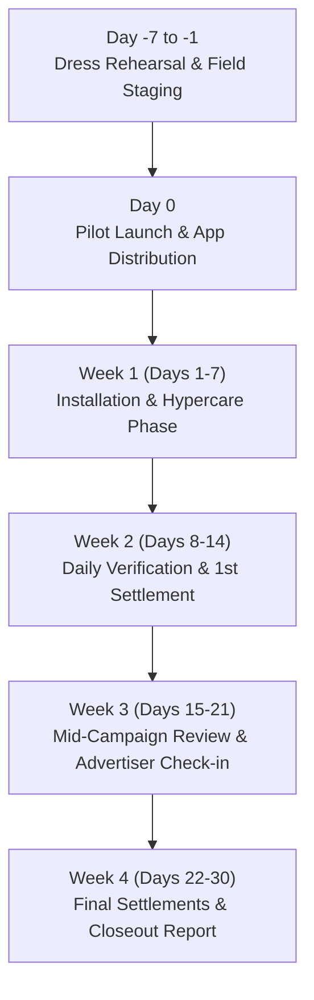

# Phase 15 Master Operational Playbook (Pilot Launch)

> **Document Status**: ACTIVE OPERATIONAL PLAYBOOK  
> **Target Geography**: Surat & Ahmedabad (Gujarat, India)  
> **Pilot Scope**: 50 Auto-Rickshaw Driver Partners | 5–10 Local Advertisers | 30-Day Runtime  
> **Currency**: Indian Rupee (INR - ₹) | Server Timezone: IST (UTC+05:30)

---

## 1. Executive Summary & Goals

The Phase 15 Pilot represents the closed operational launch of the Auto Poster Advertising Platform in Gujarat. The primary objective is to validate our complete physical-to-digital loop under real-world street conditions before scaling across Western India:

1. **Driver Operational Loop**: Onboarding -> KYC verification -> Poster pickup & installation -> Daily photo verification -> Daily wallet credit -> UPI/Bank payout.
2. **Advertiser Experience**: Self-serve campaign creation -> Zone selection -> Creative review -> Razorpay escrow funding -> Proof gallery -> Mid-campaign & final reporting.
3. **Admin & Field Operations**: Fast KYC reviews (<2h), fraud detection (phash/dhash duplicate flags, location clustering), and partner support response (<15m).

### Quantitative Pilot Success Gates
- **Driver Daily Photo Adherence**: > 88% compliant submissions daily between 06:00 and 22:00 IST.
- **Driver Retention**: >= 85% of onboarded drivers complete the full 30-day campaign without unexcused drops.
- **Advertiser Net Promoter Score (NPS)**: >= +40 at mid-point and campaign completion.
- **Financial Reconciliation Error Rate**: 0.00% variance between platform escrow ledger and Razorpay nodal settlements.

---

## 2. 30-Day Master Schedule (Day -7 to Day +30)

### Day -7 to Day -1: Field Staging & Readiness Check
- [ ] Run `npm run pilot:readiness-check` daily; verify all checks return `PASS`.
- [ ] Finalize local print shop partner in Surat (Varachha / Ring Road) for physical vinyl poster prints.
- [ ] Hand-deliver 200 physical A5 Driver Partner Cards to local auto stands and CNG fueling stations.
- [ ] Pre-generate 50 active driver invite codes (`PILOT-DRV-XXXX`) via `/admin/pilot-command-center`.
- [ ] Complete team training on Second-Look Quality Review (`/admin/quality-review`).

### Day 0: Launch Day
- [ ] Super Admin and Verification Officer sign off all 8 gates in `/admin/launch-readiness`.
- [ ] Send initial welcome WhatsApp messages with APK link and unique invite codes to Cohort 1 drivers.
- [ ] Open Advertiser campaign creation for selected pilot brand partners (e.g., local textile, jewelry, clinics).
- [ ] Operations room stand-up at 08:00 IST; monitor Pilot Command Center live telemetry.

### Week 1 (Days 1 to 7): Poster Installation & Hypercare
- [ ] Drivers pick up printed posters at partner print shops or field hubs.
- [ ] Drivers upload installation proof photos via driver app.
- [ ] Verification team reviews installation photos within 2 hours.
- [ ] ₹150 installation allowance automatically credited to driver wallet upon approval.
- [ ] Daily stand-up at 08:30 IST reviewing the automated `pilot-daily-brief` email.

### Week 2 (Days 8 to 14): Daily Routine & First Settlement
- [ ] Daily photo submission window: 06:00 AM to 10:00 PM IST.
- [ ] Reminder push notifications dispatched at 17:00 IST to drivers who have not yet submitted.
- [ ] Automated phash / dhash scan detects duplicate or historical photo attempts.
- [ ] Second-Look QC randomly audits 20% of auto-approved photos.
- [ ] First pilot driver payout cycle executed; verify 100% successful UPI transfers.

### Week 3 (Days 15 to 21): Mid-Campaign Check-in
- [ ] Generate interim campaign performance PDF reports (`CAMPAIGN_INTERIM`) for advertisers.
- [ ] Trigger in-app NPS survey for advertisers and drivers.
- [ ] Inspect physical vehicles at high-density auto stands (ad-hoc spot check of 10 autos).
- [ ] Handle any poster damage or re-paste requests via `PosterFixNotice` workflows.

### Week 4 (Days 22 to 30): Campaign Completion & Closeout
- [ ] Day 29: Final daily photos submitted and approved.
- [ ] Day 30: Final campaign closeout settlement processed in ledger.
- [ ] Full driver earnings balance paid out to registered bank accounts/UPI IDs.
- [ ] Final campaign performance PDF report (`CAMPAIGN_FINAL`) delivered to advertisers.
- [ ] Convene post-pilot review meeting to evaluate commercial scale-up criteria.

---

## 3. Escalation Matrix & SLA Targets

| Incident Type | Severity | Response Target | Resolution Target | Primary Owner | Escalation |
| :--- | :--- | :--- | :--- | :--- | :--- |
| Driver App Crash / Login Block | P1 | < 15 mins | < 2 hours | Mobile Lead | Tech Lead |
| Payout Failure / Bank Rejection | P1 | < 30 mins | < 4 hours | Finance Officer | Super Admin |
| False Rejection Dispute | P2 | < 1 hour | < 6 hours | Verification Officer | Ops Lead |
| Poster Damage / Peeling | P3 | < 2 hours | < 24 hours | Field Lead | Partner Print Shop |
| General App Feedback | P4 | < 4 hours | < 48 hours | Support Desk | Product Lead |

---

## 4. Emergency Kill-Switch & Rollback Protocols

If a critical incident occurs (e.g., fraudulent photo syndicates, escrow accounting mismatch, major server vulnerability):

1. **Pause New Registrations**: Flip setting `pilot_invite_only` to `true` and exhaust active invite codes via `/admin/pilot-command-center`.
2. **Halt Payouts**: Flip setting `finance_payouts_enabled` to `false` in `/admin/settings` (instantly blocks automated and manual fund transfers).
3. **Maintenance Mode**: Enable `maintenance_mode = true` to display user-friendly maintenance notice while preserving ledger data.
4. **Disaster Recovery**: Refer to `api/docs/runbooks/POINT_IN_TIME_RECOVERY.md` for database restore drills.

