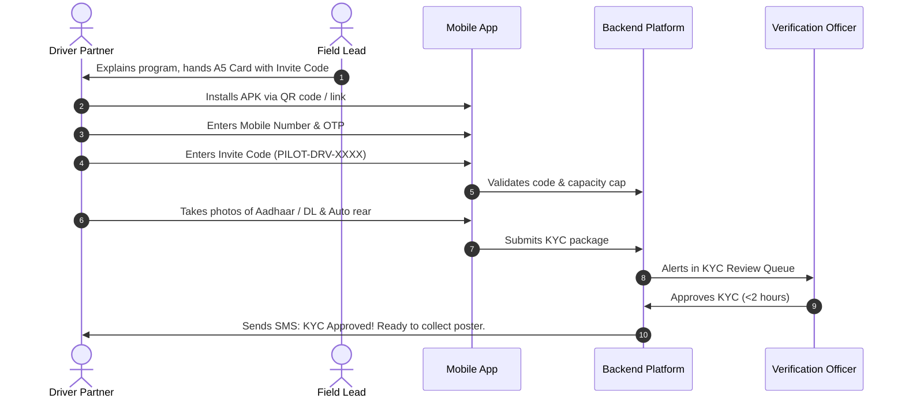

# Phase 15 Driver Recruitment & Onboarding Guide

> **Document Status**: ACTIVE FIELD GUIDE  
> **Pilot Geography**: Surat (Ring Road, Varachha, Railway Station) & Ahmedabad (Kalupur, Maninagar, SG Highway)  
> **Target Vehicles**: 50 Commercial Auto-Rickshaws (Bajaj RE / TVS King / Piaggio Ape)

---

## 1. Field Recruitment Protocol

### Step 1: Hotspot Selection & Field Timing
- **Morning Peak (07:30 – 10:30 IST)**: Major Railway Stations and Inter-City Bus Terminals (Surat Central, Ahmedabad Kalupur). Drivers waiting in arrival queues.
- **Afternoon CNG Fueling Lulls (13:30 – 16:00 IST)**: Adani Gas / Gujarat Gas CNG stations. Drivers routinely queue for 20–45 minutes for refueling, creating the ideal window for 3-minute app walkthroughs.

### Step 2: Pitch & Value Proposition (in Gujarati & Hindi)
- **Hindi Pitch**: *"Namaste bhai! Apne auto par poster lagakar har mahine ₹3,000 se ₹4,000 extra kamayein. Roz subah 1 photo khinchni hai app mein, aur paise sidhe aapke bank account ya UPI mein har hafte credit honge. Koi advance fees nahi."*
- **Gujarati Pitch**: *"Namaste bhai! Tamari auto-rickshaw par advertising poster lagavine dar mahine ₹3,000 thi ₹4,000 extra kamao. Roz fakt ek photo mobile app ma mukvani che, ane paisa seedha tamara bank account ma aavi jashe."*

### Step 3: Vehicle Eligibility Inspection Checklist
Field leads must inspect the auto-rickshaw against the following standards before handing an Invite Code:
- [ ] Commercial yellow-and-black / green-and-yellow permit plates active.
- [ ] Rear exterior hood / back panel clean, intact, with no severe rust, rips, or large dents.
- [ ] No conflicting or obscene existing vinyl advertisements pasted on the back hood.
- [ ] Smartphone inspection: Driver must have Android phone (Android 8.0+) with working rear camera and active 4G/5G data connection.

---

## 2. Onboarding & Registration Flow

---

## 3. Poster Pickup & First Installation

1. **Pickup Location**: Partner Print Shop (e.g., *Om Graphics & Signages, Ring Road, Surat*).
2. **Installation Verification**:
   - Driver or technician pastes the high-grade non-damaging outdoor vinyl poster on the rear hood.
   - Driver opens Auto Poster Driver app, navigates to "Upload Installation Photo".
   - App enforces live rear camera capture with GPS coordinates and orientation guide.
   - Verification Officer reviews within 2 hours.
   - On approval: ₹150 installation credit immediately reflects in Driver Wallet.

